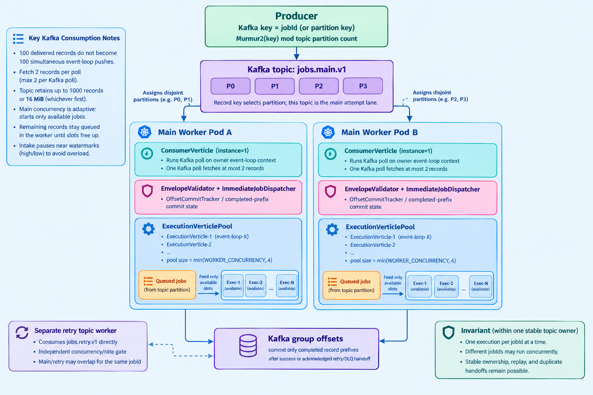
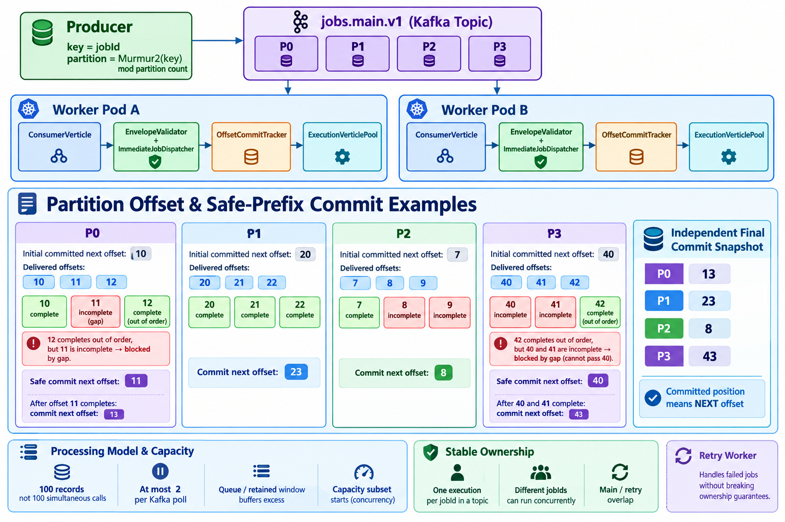

# Agentic job scheduler

A Java 21 learning project for immediate Kafka job processing and GH-600 agent
supervision. [Spec 002](specs/002-kafka-job-scheduling.md) defines the intended
worker service. **Currently implemented:** the L01–L06 runtime and the H03–H06
hardening pass for admission fairness, startup safety, and Kafka offset
semantics. The worker now enforces the process-wide active-handler cap,
allocates replacement capacity only to runnable job-lane heads, refuses
mismatched topic counts, and distinguishes new-consumer-group startup from an
established group with invalid/out-of-range offsets.

Broker evidence covers retry and failed-send recovery, retry-worker
rate/concurrency limits and attempt progression, bounded malformed/
oversized/wrong-partition DLQ routing, pause/poll/commit/resume, main adaptive
limits, worker pressure, independent partition commits, rebalance/stale
callback handling, and the final H03–H06 runtime assertions. Compose evidence
covers separate main/retry processes, scaling retry to two replicas, DLQ
routing, and replay after Kafka broker restart. The B19 cancellation contract
keeps the gate and source offset until the handler confirms it has stopped; an
unconfirmed cancellation remains incomplete.

See the [arc42 architecture documentation](arch.md) for topic ownership,
per-job queues, safe commits, the runtime boundary, and ADRs 1–10.

For a runnable 1,200-record, 12-partition validation, see
[the direct-Kafka worker demo guide](demo_direct-kafka.md). It documents the test scope, parameters,
direct-Kafka publication, timestamped handler verification, and lag/commit
checks. [The HTTP admission demo](demo_http.md) records the same workload
through `POST /v1/jobs`.

The [adaptive limiter demo](demo_adaptive_limiter.md) runs healthy, slow, and
recovery phases against one main-worker pod and records per-window limit,
latency, and observed handler-concurrency evidence.
[Spec 007](specs/007-adaptive-external-service-pressure.md) defines the proposed
typed handling for external REST/DB `503`, unavailable, and timeout signals.

## Kafka polling and event-loop behavior

<table>
  <tr>
    <td></td>
    <td></td>
  </tr>
  <tr>
    <td align="center"><strong>Polling and event-loop overview</strong></td>
    <td align="center"><strong>Partition offset and safe-prefix examples</strong></td>
  </tr>
</table>

One consumer verticle is the Kafka poller and owner-context serializer for a
pod. It can fetch at most two records per poll. Those records enter the
process-wide retained-work window and partition dispatch queues; they do not
all become immediate handler calls.

The execution pool has
`min(WORKER_CONCURRENCY, 4)` execution verticles. The main adaptive limit and
retry concurrency/rate gates decide how many queued heads can start. A stable
topic owner permits one execution for a `jobId` at a time, while different
`jobId` values may run concurrently. Main and retry workers are separate and
may overlap for the same `jobId`.

Kafka intake pauses near the retained-work high watermark (1,000 records or
16 MiB) and resumes below the configured 50% window level. The consumer
continues processing retained work and commits only completed record prefixes
after success or acknowledged retry/DLQ handoff.

For example, an offset is a record number, while the Kafka committed position
is the next offset: P0 records 10–12 with offsets 10 and 12 complete can
advance only to 11 because offset 11 is unfinished, assuming 10 was the prior
next-offset position. After offset 11 completes, P0 may commit 13. P1 can
independently commit 23 after offsets 20, 21, and 22 complete. P3 cannot commit
past offsets 40 or 41 even if offset 42 completes first; completion of 40 and 41
permits the next commit at 43.

See [section 5.2 of the architecture](arch.md#52-level-2-consumer-verticle-and-partition-ownership)
for the complete partition, ownership, and runtime boundaries.

## Build and test

Requirements: JDK 21 or newer and Maven 3.6.3 or newer. Compilation targets Java
21. Maven needs access to Maven Central on the first build. Docker is required by
`mvn verify` for the broker-backed L06 integration tests.

```sh
mvn test
mvn package
```

Unit results are in `target/surefire-reports/`. Packaging produces
`target/agentic-job-scheduler-0.1.0-SNAPSHOT.jar`; runtime entry points are
`com.example.agenticjobscheduler.runtime.WorkerMain` and
`com.example.agenticjobscheduler.runtime.SampleProducerMain`; the separate HTTP
entry point is `com.example.agenticjobscheduler.admission.HttpApiMain`. `mvn test` and
`mvn package` run the unit suite. `mvn verify` also runs Testcontainers cases in
`src/test/java/**/*IT.java` for pause/poll/commit/resume and worker handoff,
partition-routing, failed retry publication recovery, and DLQ behavior. Compose
manual checks exercise broker restart/replay. `KafkaWorkerCrashIT` verifies replay
after child-JVM loss; `KafkaWorkerIT` covers confirmed and unconfirmed handler
cancellation. The latest [C12 validation](docs/tasks/evidence/C12-cooperative-sticky-validation.txt)
passed 127 unit tests and 20 Kafka integration tests. Kubernetes fault testing and
the broader campaign remain pending; see the [chaos runbook](docs/CHAOS.md).

## HTTP admission

Clients that should retain an HTTP integration can submit one job at a time:

```sh
curl --fail-with-body \
  -H 'Content-Type: application/json' \
  -d '{"jobType":"demo.echo","payload":{"message":"hello"}}' \
  http://127.0.0.1:8080/v1/jobs
```

The response is `202 Accepted` only after Kafka acknowledges the canonical
Spec 002 record on `jobs.main.v1`. It is not a completion result. The HTTP role
has no GET/status/query endpoint and does not call the worker handler.

Clients that need retry-safe requests should generate and send both `jobId` and
`executionId` as canonical lowercase UUIDs. Repeating the same request may
append another physical Kafka record; the service provides no durable HTTP
deduplication. A `503` after publication is ambiguous: the record may have
reached Kafka. Generated IDs are new on every request that omits them.

The local Compose role is separate from main and retry workers:

```sh
docker compose up --build kafka main-worker-a main-worker-b http-api
```

It binds only to `127.0.0.1:8080`. Production TLS, authentication, and
authorization remain deployment concerns and are not provided by this local
demo. Operational endpoints are:

- `GET /health/live`
- `GET /health/ready`
- `GET /metrics` (bounded Prometheus labels)

The HTTP process runs one `HttpAdmissionVerticle` and one asynchronous Kafka
producer. It does not deploy a consumer, job handler, or worker execution
verticle, and it cannot reuse worker handler permits or offsets. Main, retry,
and HTTP roles scale independently. See [Spec 006](specs/006-http-admission-api.md)
and [ADR 11](arch.md#adr-11-http-admission-is-a-separate-producer-only-process).

## Restart with partially committed partitions

An established consumer group can have offsets on only some partitions. On
restart, the worker preserves those committed positions and initializes only
partitions reported by Kafka as missing an offset at their earliest retained
record. This applies to both main and retry workers. It does not commit offsets
until records complete normally. Out-of-range offsets still fail visibly instead
of silently resetting. No manual consumer-group offset initialization is needed.

The [R02 task](docs/tasks/R02-sparse-offset-startup.md) records the regression and
supersedes the manual workaround used in the first failure demo.

## Partition reassignment

Main and retry workers explicitly use the classic group protocol with
`org.apache.kafka.clients.consumer.CooperativeStickyAssignor` as their sole
partition assignor. Membership changes move partitions as needed while retaining
unaffected partitions and their running/queued work. This reduces disruption; it
does not pin a jobId to a pod or wait for its handler to finish before moving it.
Static membership is not enabled. Replay and cross-owner overlap remain possible.

Before a rolling upgrade, check the assignors supported by every existing member.
Kafka 4.2's default `[RangeAssignor, CooperativeStickyAssignor]` supports removing
Range in a rolling upgrade; a group containing Range-only members needs an
intermediate compatible configuration or a coordinated restart. See the
[Kafka assignor configuration](https://kafka.apache.org/42/configuration/consumer-configs/#partition.assignment.strategy).

The [C12 task record](docs/tasks/C12-cooperative-sticky.md) records actual validation
of `KafkaWorkerCooperativeIT`: both roles, repeated joins/departures, retained
same-job lanes, broker-observed commits, and stale moved-owner outcomes. Run it
with `mvn -B -ntp -Dit.test=KafkaWorkerCooperativeIT verify` (Docker required).
[Spec 005](specs/005-partition-reassignment-chaos.md) tracks the wider chaos work;
this focused test does not establish Kubernetes or full chaos acceptance. The
[chaos runbook and acceptance ledger](docs/CHAOS.md) list runnable checks and gaps.

## GitHub Actions

[The Maven CI workflow](.github/workflows/maven.yml) runs on pull requests targeting
`main` and pushes to `main`, using Temurin Java 21 and cached Maven dependencies.
`mvn -B -ntp package` runs the unit tests and builds the library JAR. Each run saves
`test-reports` (including on test failure) and, on success, `library-jar` artifacts
for 14 days. See the [CI task record](docs/tasks/CI01-maven-actions.md) for run evidence.

The workflow has read-only repository permissions, pinned action revisions, and
no deployment step. Required-check branch rules are separate and have not been
configured by this task. CI runs `package`, so it does not run the Docker-backed
integration tests.

## Validation API

`com.example.agenticjobscheduler.messaging.EnvelopeValidator` takes a set of
registered job types. Call `validateMain(byte[] key, byte[] value)` or
`validateRetry(byte[] key, byte[] value)` with raw UTF-8 bytes. The main method
returns a normalized JobEnvelope; omitted remainingAttempts becomes 3. Retry validation
returns RetryEnvelope and requires the nested job's remainingAttempts explicitly.

```java
var validator = new EnvelopeValidator(Set.of("demo.echo"));
JobEnvelope job = validator.validateMain(keyBytes, messageBytes);
```

On rejection it throws EnvelopeValidationException with a stable `code()` and
sanitized message. It does not attach the underlying parser exception or include
payloads. The Kafka worker uses the code and original record to construct bounded
DLQ output. No I/O or Kafka offset changes occur during validation.

The validator rejects unknown fields (including scheduledAt), invalid or
noncanonical UUIDs, mismatched keys, unknown job types, wrong JSON types, invalid
attempts, malformed UTF-8/JSON, duplicate properties, trailing content, and records
beyond 256 KiB main / 512 KiB retry limits. Payloads must be JSON objects and are
returned as defensive copies. JSON nesting is capped at 100 main levels (101 for
the retry wrapper) and numeric tokens at 1,000 characters. The runtime separately
checks that the keyed job is on its expected partition.

## Completion and offset API

`com.example.agenticjobscheduler.execution.OffsetCommitTracker` tracks a fixed set
of assigned topic partitions with a configurable total retained-record bound.
Use one owner context for every call; this class is not thread-safe.

1. Register every fetched record in increasing partition-offset order with
   `delivered(SourceRecord)`, before dispatch. Retain its opaque delivery handle.
2. Call `complete(handle, outcome)` only on handler success, retry acknowledgment,
   or DLQ acknowledgment. Pending/failed sends leave the source incomplete.
3. `beginCommit()` returns an optional immutable map of explicit next offsets.
   Send that snapshot through the future Kafka adapter. It cannot cross an
   incomplete delivered record, handles offset gaps, and advances partitions
   independently. Another request cannot begin until this one finishes.
4. Report the exact request to `commitSucceeded(batch)` or `commitFailed(batch)`.
   Success frees only the acknowledged prefix; failure retains all results for
   retry. Report synchronous send failures too. Do not release an outstanding
   request merely because a local timer expired.

The bound includes completed-but-uncommitted records. Admission failure requires
the caller to retain fetched work and pause intake, never drop records. Payload
byte limits, fetch overshoot, process-wide accounting, and pause/resume are not
implemented by this tracker. Rebuild the tracker on ownership changes; the
future runtime must invalidate old callbacks and handle revocations before using
a new tracker.

Tests establish B05/B15 library behavior and **simulate** B09 crash/replay using a
fake broker offset store. They do not establish live Kafka durability. Success or
handoff acknowledgment before commit can replay after a crash, including duplicate
handoffs. This follows Kafka's [manual offset/replay contract](https://kafka.apache.org/41/javadoc/org/apache/kafka/clients/consumer/KafkaConsumer.html).
The `KafkaWorker` runtime adapts this tracker to Vert.x Kafka and issues explicit
partition commits. Worker-level out-of-order completion across independent
partitions and rebalance races remain to be tested.

## Immediate dispatch API

Each main or retry process deploys one consumer verticle and
`min(WORKER_CONCURRENCY, 4)` execution verticles. Kafka may assign any number
of the role's partitions, including zero, to that consumer. Execution verticles
receive handler invocations, not Kafka consumers or partition ownership. They
are event-loop verticles for nonblocking handlers, not a blocking-worker thread
pool; the existing per-process concurrency and retry-rate limits still govern
starts. The execution pool stays available while the consumer drains on
shutdown. Assignment invalidation suppresses a queued invocation that has not
passed its start check, but cannot fence an invocation racing ownership loss.

`ImmediateJobDispatcher` owns one topic and a fixed partition assignment on a
Vert.x event-loop context. Construct and call it on that context. `submit()` takes
`JobExecution(source, validatedJob, attempt)` and starts a per-job queue head as
soon as fixed handler capacity is available. Different IDs can run concurrently;
ready partitions take turns, with FIFO runnable job lanes within each partition.
Main and retry dispatchers have independent gates and can overlap for the same ID.

`JobHandler.execute()` must return promptly with a `Future<Void>` that completes
only after the operation has actually stopped. Success completes the record and
releases its gate. Failure releases handler capacity but leaves the job in
`HANDOFF_PENDING`. Observe `Submission.handlerStopped()` and, after a publisher's
actual broker acknowledgment, call `handoffAcknowledged()` with
`RETRY_ACKNOWLEDGED` or `DLQ_ACKNOWLEDGED`. Failed sends make no acknowledgment call
and must not rerun the handler. L04 supplies failure classification; the
`KafkaWorker` performs Kafka publication and records the acknowledgment.

All state changes and commit calls run on the owner context; off-context calls
are rejected and handler completions are marshalled back. Register fetched records
in partition order, and use the dispatcher's `beginCommit()`/commit-result methods
for L02's safe prefixes. Completed-but-uncommitted records still count toward the
configured record bound. Rejected admission never permits dropping fetched work.

Handlers must tolerate replay and concurrent duplicates; the stable identity is
`execution.job().jobId()` plus `execution.job().executionId()`. A synchronous throw
is permitted only before starting work. A null future violates the contract and
leaves the submission `STUCK`, holding its gate and capacity. A future that never
finishes also retains both; timeout/cancellation and recovery are not implemented.
Do not complete a future early to simulate cancellation or block the event loop.

This remains a stable-assignment component with a resizable per-dispatcher
capacity. The runtime creates one dispatcher per assigned partition, apportions
the main adaptive limit across active/queued partitions, and independently limits
retry concurrency and starts. Kafka rebalance callbacks invalidate revoked
dispatchers; uncommitted records remain replayable. The demo worker does not
provide a general-purpose confirmed cancellation API for production handlers.
Unit tests use real Vert.x contexts and controlled futures; broker-specific
behavior is covered separately. See the
[L03 task record](docs/tasks/L03-immediate-processing.md) for its trace and handoff.

## Retained-work window API

`com.example.agenticjobscheduler.execution.ProcessingWindow` provides
thread-safe, process-wide accounting for fetched work held until its source
offset commit is acknowledged. Share one instance across the process's intake
paths. `tryReserve(records, bytes)` accounts a fetched batch, including key/value
bytes measured by the adapter. Keep its reservation while the record is queued,
running, awaiting retry/DLQ handoff, or completed but uncommitted. Call
`commitAcknowledged(reservation)` only after the corresponding Kafka commit
succeeds.

The defaults bound retained work to 1,000 records or 16 MiB. Configure maximum
fetch count/bytes so one outstanding fetch fits within the reserved headroom.
`intakePaused()` becomes true at either adjusted high watermark and clears only
when **both** count and bytes fall below half of their respective watermarks.
A failed `tryReserve` must not discard the fetched batch or dispatch it outside
the window.

`ProcessingWindowKafkaController` applies the window signal to assigned
partitions through Vert.x Kafka's partition-level pause/resume API. The worker
reserves each poll batch before dispatch. Under active ownership it releases a
batch reservation after all covered source records have acknowledged commits;
revoked work has separate retirement paths that do not complete its source. The
Testcontainers-backed `ProcessingWindowKafkaIT` verifies pause/poll/commit/resume;
`KafkaWorkerIT` exercises handoff/DLQ and broker-pause recovery; historical Compose
checks cover broker restart. Full revoked-state retirement and outage-boundary
coverage remain pending in the [chaos ledger](docs/CHAOS.md#acceptance-ledger).
See the [L06 task record](docs/tasks/L06-backpressure-recovery.md) for earlier evidence.

## Kafka worker demo

The Compose demo runs a single-broker KRaft Kafka, separate main and retry consumer
groups, and a persistent named volume. The worker provisions `jobs.main.v1` and
`jobs.retry.v1` with 12 partitions by default and `jobs.dlq.v1` with 3. The demo
handler logs job identity and performs no external side effects.

```sh
docker compose up --build -d
docker compose --profile tools run --rm sample-producer
docker compose logs -f main-worker retry-worker
docker compose up --scale retry-worker=2 -d
```

For the 1,200-record, 12-partition demo:

```sh
docker compose up --build -d
docker compose --profile tools run --rm sample-producer --load-1200
docker compose logs -f main-worker-a main-worker-b
docker compose exec kafka /opt/kafka/bin/kafka-consumer-groups.sh \
  --bootstrap-server localhost:9092 --describe --group job-main-v1
```

The load sends 1,200 records with randomized partition assignments across
P0–P11; with seed 1200, the Java `Random` distribution is
`105,100,94,98,108,90,88,122,98,103,97,97`. These are randomized partition counts,
not fixed 100-per-partition values. Each handler log
includes an ISO timestamp, `loadSequence`/`loadTotal`, `demoDelayMillis`,
`activeAtStart`, and `peakActive`. The demo adds a 100 ms handler hold by
default so concurrent in-flight executions can be observed. The live run measured pod-specific peaks. With Pod A at 16 permits and
Pod B at 8 permits, aggregate theoretical concurrency is 24. This is not proof
of 1,000 or 1,200 simultaneous handlers. Success requires 1,200 handled lines,
no retries/DLQ entries for normal records, and `LAG=0` for P0–P11 in the
consumer-group describe output. Kafka retains the twelve committed next offsets
independently; the describe result proves lag zero for the current group, while
the handler lines prove each load record stopped successfully.

`WORKER_ROLE` is `main` or `retry`; `KAFKA_BOOTSTRAP_SERVERS`,
`WORKER_CONCURRENCY`, `KAFKA_TOPIC_PARTITIONS`, and
`WORKER_RETRY_STARTS_PER_SECOND` configure each process. Retry workers default
to concurrency 2 and one handler start per second per pod; set
`RETRY_WORKER_CONCURRENCY` and `RETRY_WORKER_STARTS_PER_SECOND` in Compose to
adjust them. Main workers start at 16 permits and adapt between 1 and 128.
`docker compose down` stops only this project; it preserves Kafka data. Do not
use `docker compose down -v` unless deleting the demo backlog is intended. The
single-broker Compose deployment is for learning, not a production durability
profile.

To demonstrate exhaustion with one deliberately failing sample job:

```sh
docker compose --profile tools build sample-producer
docker compose --profile tools run --rm sample-producer --fail
docker compose logs -f main-worker retry-worker
```

The demo-only payload flag `demoFail: true` causes each execution to fail. With
three remaining attempts, logs show main with 3, retry with 2, retry with 1,
and the final DLQ record contains 0. Omit `--fail` for the normal successful demo.
Rebuild workers with `docker compose up --build --scale retry-worker=2 -d`
when applying source changes.

## Remaining attempts

`remainingAttempts` includes the execution about to run. Each handler failure
subtracts one. A positive result goes to `jobs.retry.v1` (including failures
already on that topic); zero goes to `jobs.dlq.v1`. Success completes the source.

| Execution | Incoming remainingAttempts | After failure | Destination |
| --- | --- | --- | --- |
| Main | 3 | 2 | Retry |
| Retry | 2 | 1 | Same retry topic |
| Retry | 1 | 0 | DLQ |

All handler failures use this budget, including `PermanentJobFailure`. Invalid
input/routing still goes directly to DLQ. A failed Kafka publication resends the
same already-decremented envelope and keeps the source incomplete. Replay may
repeat executions; this is a logical budget, not a durable deduplication limit.
`attempt` remains diagnostic metadata in retry/DLQ records.

This replaces `maxAttempts`, which is now rejected as an unknown field. The
main default remains 3; runnable envelopes require 1–100. Retry envelopes require
an explicit positive budget, and `attempt + remainingAttempts - 1 <= 100`.
This is a breaking development wire change with unchanged v1 topic/schema names:
coordinate producer/worker upgrades and drain or explicitly migrate old backlog.
Old records replayed into the new worker go to invalid-input DLQ. Existing Kafka
data is not automatically migrated or deleted.

## Retry wire example

```json
{
  "schemaVersion": 1,
  "job": {
    "schemaVersion": 1,
    "jobId": "e2be7c92-05f9-48d3-aeb2-4e695d857151",
    "executionId": "5d0d8409-4276-4ec8-8fd0-941ed977ff00",
    "jobType": "demo.echo",
    "payload": {},
    "remainingAttempts": 2
  },
  "attempt": 2,
  "handoffId": "92a0e16a8b0cc0557cc22b7a6c6ae4b6687e2d12f8b65bb2bd9db2b347b1d5e3",
  "originalSource": { "topic": "jobs.main.v1", "partition": 0, "offset": 42 },
  "failedSource": { "topic": "jobs.main.v1", "partition": 0, "offset": 42 },
  "errorCode": "TRANSIENT_FAILURE"
}
```

Handoff IDs are SHA-256 of failed-source topic, partition, offset, and next attempt,
separated by newline characters without a final newline. They identify a handoff,
not a permanent execution-deduplication guarantee. See Spec 002 for main/retry
ordering and at-least-once delivery limitations.

## Review and learning

Start with the [L01 task record](docs/tasks/L01-envelope-validation.md),
[L02 task record](docs/tasks/L02-completion-offsets.md),
[L03 task record](docs/tasks/L03-immediate-processing.md), and the
[GH-600 learning guide](docs/gh-600-learning-guide.md). B01 validation is covered;
B17's malformed, oversized, and wrong-partition records are exercised against
Kafka. The broker tests verify retry handoff and failed-publication recovery: while
retry publication is rejected, the source offset remains unchanged and the
handler is not rerun; after restoring publication, the retry is consumed and the
source advances. The Compose demo separately verified persistent broker restart
and main processing of queued work. Recovery after worker process loss and the
broader B14–B20 worker-level set remain open.

Pinned dependencies: Vert.x Core and Kafka client 5.2.1, Apache Kafka clients
4.2.0, [Jackson BOM 2.21.7](https://github.com/FasterXML/jackson/wiki/Jackson-Release-2.21.7),
and [JUnit 5.14.1](https://docs.junit.org/5.14.1/_exports/junit-user-guide-5.14.1.html).
L03 aligns Jackson with Vert.x. Record the current dependency scan result in the
L06 task evidence before claiming the full increment complete.
For the 1,200-record two-main-worker randomized demo, see
[demo_direct-kafka.md](demo_direct-kafka.md) for seed counts, partition distribution, retained-window
configuration, replay evidence, and per-pod graph links.
