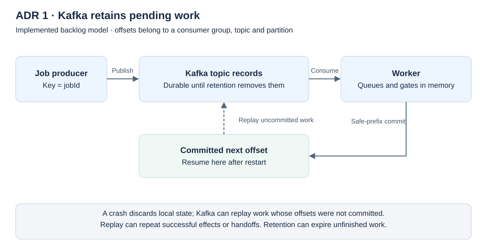
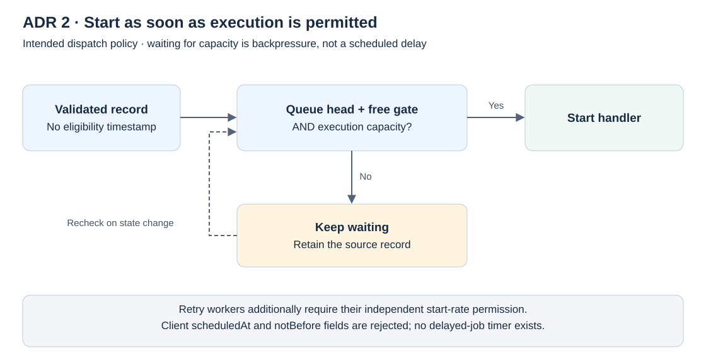
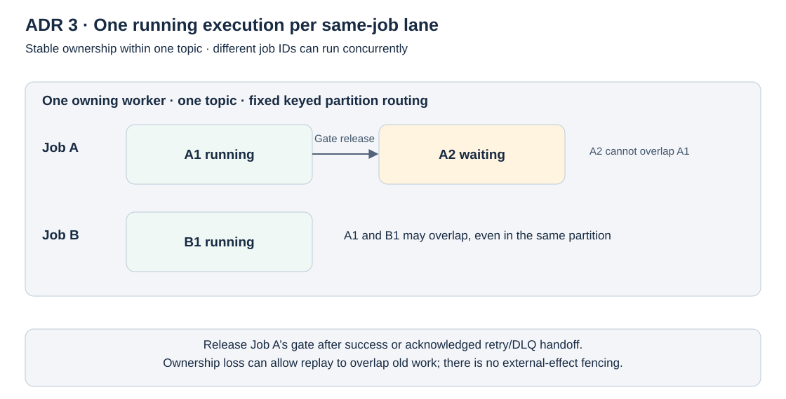
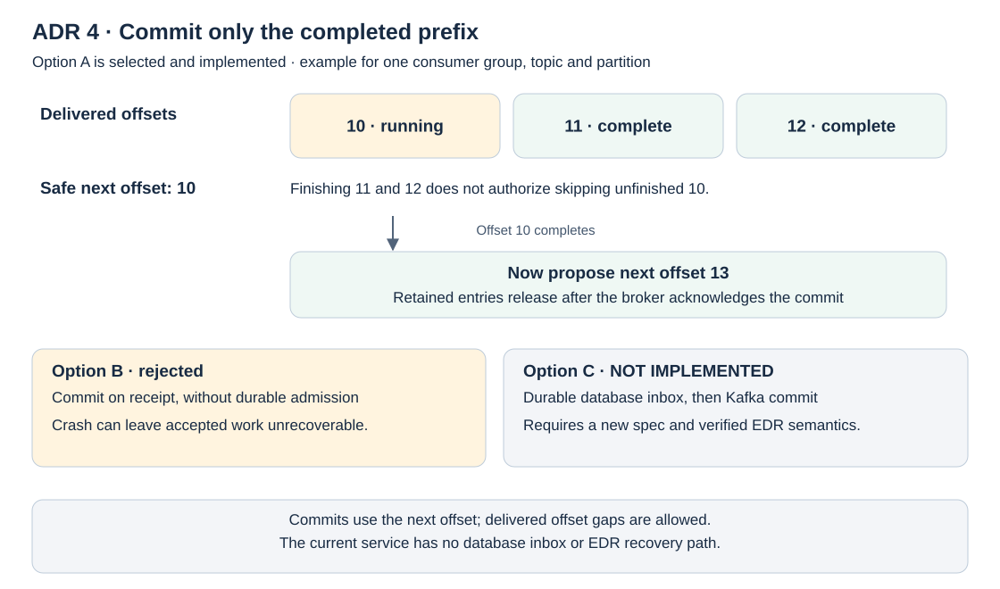
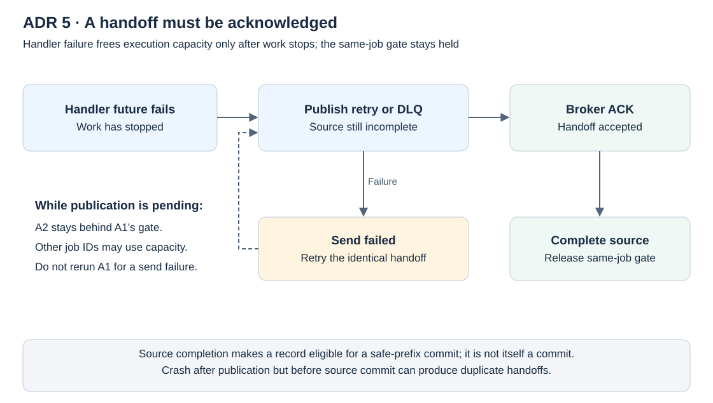
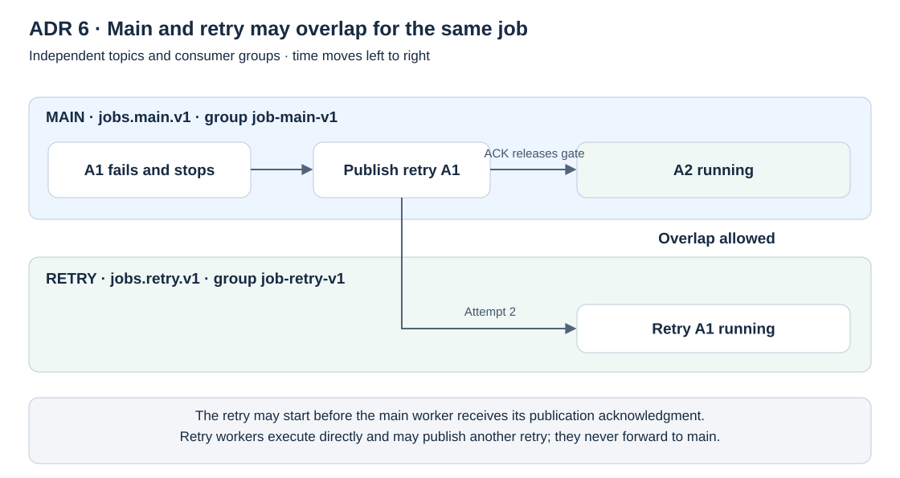
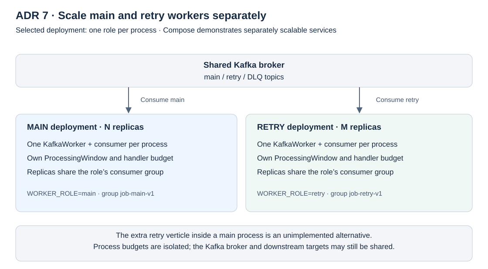
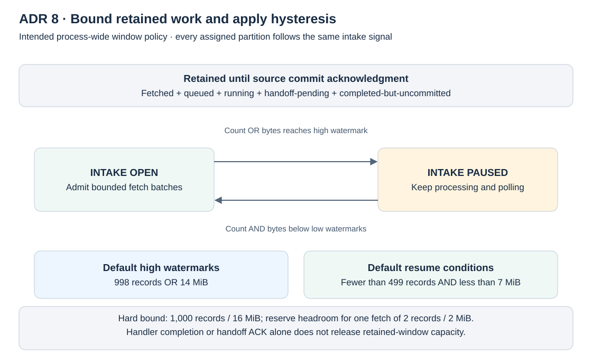
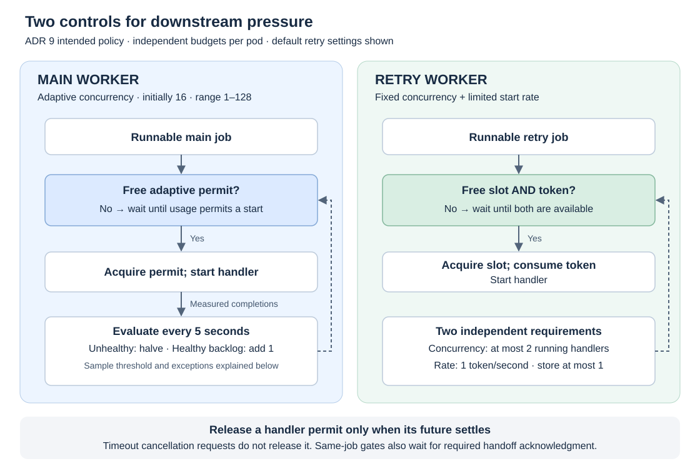
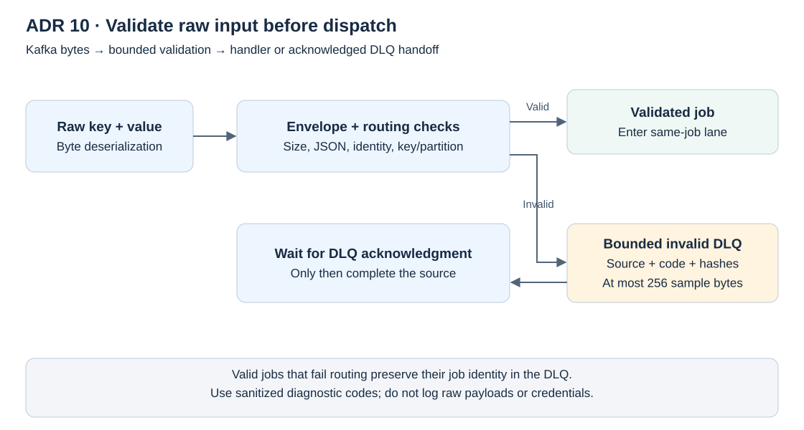

# Architecture documentation (arc42)

Snapshot: 2026-10-10, L01–L06 worker-runtime work. [Spec 002](specs/002-kafka-job-scheduling.md)
is the requirements and architecture authority; this document follows the
[arc42](https://arc42.org) template and records decisions as ADRs (section 9).
[Spec 001](specs/001-job-lifecycle.md) is historical.

---

## 1. Introduction and goals

### 1.1 Requirements overview

Clients publish jobs to Kafka. Vert.x workers consume them as soon as records,
worker capacity, and the adaptive limiter allow. A retryable first failure goes
to a retry topic consumed by separate, slower retry workers. Permanent or
exhausted failures go to a dead-letter queue (DLQ). Kafka records and consumer
offsets are the only durable backlog.

There is no PostgreSQL, Flyway, REST API, delayed-job timer, scheduling state
topic, or RocksDB index. EDR is deferred.

### 1.2 Quality goals

| Priority | Goal | Meaning here |
| --- | --- | --- |
| 1 | No lost work | Commit only completed record prefixes; retry/DLQ handoff acknowledged before the source completes |
| 2 | Per-job exclusion | One execution per jobId at a time within a topic under stable ownership; different IDs run concurrently |
| 3 | Bounded resources | Retained records/bytes and handler concurrency are capped; intake pauses instead of growing memory |
| 4 | Operational independence | Main and retry workers scale, fail, and are rate-limited independently |
| 5 | Explainable behavior | Invariants are tested at crash/commit boundaries with recorded evidence |

### 1.3 Stakeholders

| Role | Expectation |
| --- | --- |
| Job clients | Submit jobs by publishing to `jobs.main.v1`; replay-tolerant outcome |
| Handler authors | Implement replay-safe, concurrency-tolerant handlers using `(jobId, executionId)` as idempotency key |
| Operators | Scale roles, monitor lag/oldest-unprocessed age, inspect the DLQ |
| Maintainers/reviewers | Traceable acceptance IDs (B01–B20) and evidence per increment |

---

## 2. Constraints

| Constraint | Source |
| --- | --- |
| Java 21, Maven, Vert.x, JUnit 5, Testcontainers, Docker Compose | Spec 002 §1 |
| Kafka provides durability; no database or state store | Spec 002 §1 |
| Fixed topic partition counts (default 12/12/3) | Spec 002 §3 |
| Client records ≤ 256 KiB; internal records reserve ≥ 512 KiB | Spec 002 §4 |
| No HTTP API, production business handler, or Kubernetes deployment in this increment | Spec 002 §1 |
| Never block the event loop; never share a native Kafka consumer across threads | Spec 002 §2 |

---

## 3. Context and scope

### 3.1 Business context

```text
 Job client ──publish (key = jobId)──> jobs.main.v1 ──> Main workers ──> Job handler
                                                            │ retryable failure
                                                            ▼
                                       jobs.retry.v1 ──> Retry workers ──> Job handler
                                                            │ permanent / exhausted
                                                            ▼
                                       jobs.dlq.v1  <── (also: invalid input)  ──> Operator
```

### 3.2 Technical context

| Neighbor | Interface | Notes |
| --- | --- | --- |
| Kafka broker | Kafka protocol; idempotent producer (`acks=all`), manual-commit consumers | Local Compose: single KRaft broker, RF 1, persistent volume. Deployment baseline: 3 brokers, RF 3, min ISR 2 |
| Job handler | `JobHandler` future-returning SPI | Demo handler only; completes only after work has stopped |
| Docker/Compose | `compose.yaml`, `Dockerfile` | Roles `main-worker`, `retry-worker`, tool profile `sample-producer` |

Out of scope: HTTP clients, databases, external-effect fencing.

---

## 4. Solution strategy

| Goal | Approach | ADR |
| --- | --- | --- |
| No lost work | Kafka as backlog; explicit safe-prefix commits; acknowledged handoffs | 1, 4, 5 |
| Immediate start | Run queue heads as soon as capacity exists; no eligibility timestamps | 2 |
| Per-job exclusion | Keyed partitioning plus per-jobId FIFO gates in the owning verticle | 3 |
| Retry isolation | Separate topic, group, and worker deployment | 6, 7 |
| Bounded resources | Processing window with pause/resume; adaptive main limiter; retry token bucket | 8, 9 |
| Safe input | Validate raw bytes before dispatch; bounded DLQ samples | 10 |

---

## 5. Building block view

### 5.1 Level 1: components

| Increment | Component | Responsibility | Executed test cases |
| --- | --- | --- | ---: |
| L01 | `EnvelopeValidator` | Validate raw main/retry envelopes and preserve invocation identity | 77 |
| L02 | `OffsetCommitTracker` | Propose commits only for completed delivered prefixes | 17 |
| L03 | `ImmediateJobDispatcher` | Start eligible queue heads; serialize each jobId within its topic | 14 |
| L04 | `FailureClassifier` + `AdaptiveLimiter` | Classify retryable vs exhausted/permanent failures; main-worker backpressure policy | focused unit coverage |
| L05 | `ImmediateJobDispatcher.revokeOwnership()` | Stop admission/dispatch and ignore stale local callbacks for a revoked owner | 3 |
| L06 | `ProcessingWindow`, `ProcessingWindowKafkaController`, `KafkaWorker` runtime | Bound intake, run main/retry roles, publish acknowledged handoffs, commit safe offsets | 5 window unit + 19 dispatcher + 5 limiter + 2 Kafka integration |

These are executed cases, including parameterized inputs. L03 tests run real
Vert.x event loops with controlled handler futures; crash/replay tests use a
simulated broker store. The two L06 integration tests use a real Kafka broker
and do not constitute the full B14–B20 suite. Evidence:
[L01](docs/tasks/L01-envelope-validation.md),
[L02](docs/tasks/L02-completion-offsets.md),
[L03](docs/tasks/L03-immediate-processing.md),
[L04](docs/tasks/L04-retry-dlq-limiter.md),
[L05](docs/tasks/L05-replay-rebalances.md), and
[L06](docs/tasks/L06-backpressure-recovery.md).

Runtime classes (`runtime/`): `WorkerMain` (one role per process), `KafkaWorker`
(consumer group member), `WorkerConfig`/`WorkerRole`, `TopicProvisioner`,
`JobRecordEncoder`, `DemoJobHandler`, `SampleProducerMain`.

### 5.2 Level 2: worker verticle and partition ownership

Four partitions are shown for clarity; Spec 002 defaults main and retry to
twelve. Assignment is broker-managed and changes during rebalances.

```text
Producer: key = canonical jobId
              |
              v
       Kafka topic: jobs.main.v1
       +---------------------------+
       | P0 | P1 | P2 | P3 | ...   |
       +---------------------------+
          |    |    |    |
          +--+-+    +--+-+
             |         |
             v         v
       Verticle A   Verticle B
       owns P0,P1   owns P2,P3

Consumer group: job-main-v1

+----------------------------+  +----------------------------+
| Main worker verticle A     |  | Main worker verticle B     |
|                            |  |                            |
| Own Kafka consumer         |  | Own Kafka consumer         |
| Assigned P0, P1            |  | Assigned P2, P3            |
|          |                 |  |          |                 |
|          v                 |  |          v                 |
| EnvelopeValidator     L01  |  | EnvelopeValidator     L01  |
|          | valid job       |  |          | valid job       |
|          v                 |  |          v                 |
| ImmediateJobDispatcher L03 |  | ImmediateJobDispatcher L03 |
|   per-job queues + gates   |  |   per-job queues + gates   |
|   async JobHandler calls   |  |   async JobHandler calls   |
|          |                 |  |          |                 |
| OffsetCommitTracker   L02  |  | OffsetCommitTracker   L02  |
|   safe next offsets        |  |   safe next offsets        |
+----------------------------+  +----------------------------+
             |                              |
             +----- explicit commits -------+
                            |
                            v
                 Kafka group offsets
```

Within a consumer group each partition has one owner at a time; one consumer may
own several partitions. A worker owns its consumer and serializes queue,
completion, and commit-state mutations on its Vert.x context. Verticles are
logical components, not necessarily separate pods or dedicated threads.

With fixed partition counts and consistent keyed production, a jobId routes to
one partition per topic; different IDs can share a partition. The worker
validates the expected keyed partition before dispatch. Changing partition
counts can remap keys and is an operational migration.

An event loop starts nonblocking operations and processes callbacks; several
handlers can be in flight while state changes stay serialized. A blocking
handler needs a bounded executor. L03 marshals handler completions back to the
owner context and rejects direct API calls from the wrong context.

---

## 6. Runtime view

### 6.1 Validate before dispatch (L01)

```text
Raw Kafka key bytes + value bytes       (Kafka worker)
                |
                v
       EnvelopeValidator
          /             \
       valid           invalid
         |                |
         v                v
 JobEnvelope or      sanitized error code
 RetryEnvelope            |
         |                v
         v          bounded DLQ publication
 JobExecution       + acknowledgment
         |
         v
 L03 dispatcher
```

The 77 L01 cases cover accepted identities/payloads/defaults and rejection of
missing/unknown fields, wrong types, invalid UUIDs or keys, malformed JSON/UTF-8,
size/nesting violations, invalid retry attempts, source coordinates, and handoff
identities. `KafkaWorkerIT` verifies malformed, oversized, and wrong-partition
records reach the DLQ with bounded samples and preserved identity where valid.

`jobId` identifies a serialization lane; `executionId` identifies an invocation.
Replay keeps both IDs; there is no durable deduplication table.

### 6.2 One lane per jobId, concurrency between lanes (L03)

```text
Partition P0, delivered in this order:

 offset 10        offset 11        offset 12
    A1               A2               B1

 Dispatcher queues:

 Job A: [ A1 RUNNING ] --> [ A2 WAITING ]
 Job B: [ B1 RUNNING ]

        A1 and B1 can overlap.
        A2 must wait for A1's gate to release.
```

A queue head starts immediately when handler capacity exists. The runtime
creates one dispatcher per assigned partition, preserves per-job FIFO within it,
and allocates the process limit across busy partitions. Main capacity adapts from
five-second handler-latency/failure windows; retry workers have independent
concurrency and a per-pod one-start-per-second token bucket.

### 6.3 Completion and safe-prefix commits (L02)

Kafka's committed position is a next offset per partition, not a per-record
completion flag. Committing 13 resumes at 13; doing so while 10 is unfinished
would skip work.

```text
Step                      Offset 10   Offset 11   Offset 12   Safe progress
                          A1          A2          B1

Start A1 and B1            RUNNING     WAITING     RUNNING     none
B1 finishes               RUNNING     WAITING     COMPLETE    none
A1 finishes; A2 starts     COMPLETE    RUNNING     COMPLETE    commit 11
A2 finishes               COMPLETE    COMPLETE    COMPLETE    commit 13
Broker acknowledges 13    <---------- release retained entries ---------->
```

“None” means no new commit for this partition; it does not erase an earlier
commit. `beginCommit()` scans delivered records in order and stops at the first
incomplete one. Offset gaps are allowed. One commit request may be outstanding;
success releases only the acknowledged snapshot; failure retains results.

The 17 L02 cases cover incomplete prefixes, gaps, independent partitions/topics,
immutable snapshots, serialized requests, failed commits, record bounds, stale or
foreign handles, invalid inputs, simulated crash/replay, and 40 deterministic
shuffled completion schedules. Completed-but-uncommitted records still count
toward the record bound.

### 6.4 Capacity release versus gate release

```text
                          handler actually stops
                                   |
                        +----------+----------+
                        |                     |
                     success                failure
                        |                     |
                release capacity      release capacity
                complete record       keep record incomplete
                release Job A gate    keep Job A gate
                        |                     |
                  A2 may start         HANDOFF_PENDING
                                              |
                              publish retry/DLQ
                                   /                \
                              send fails         broker ACK
                                  |                  |
                          keep gate/record     complete record
                          retry same send      release Job A gate
                          do not rerun A1            |
                                                A2 may start
```

For supported handlers the returned future completes only after work has
actually stopped. While failed A1 awaits publication, job B may use the freed
handler slot but A2 stays blocked. The worker retries the same bounded record
after a failed send and does not invoke the handler again. A never-finishing
handler keeps its gate and capacity; a null future violates the contract and
leaves the submission `STUCK`. Shutdown pauses intake and drains for up to 30
seconds; after the deadline, outstanding records remain uncommitted for replay.
Confirmed cancellation for arbitrary handlers is not provided.

### 6.5 Main and retry overlap

```text
jobs.main.v1                         jobs.retry.v1
Group: job-main-v1                    Group: job-retry-v1
Main worker                          Retry worker (separate process)
      |                                      |
   A1 fails                                  |
      +--- publish retry A1 ---------------->|
      | wait for broker ACK                  v
      v                                 retry A1 RUNNING
 ACK received                                |
 release main Job A gate                     |
      v                                      v
 main A2 RUNNING                        retry A1 RUNNING
          \__________________________________/
                   overlap is allowed
```

Retry workers execute their own topic directly and never forward to main.
Matching partition numbers across topics create no shared lock. Retry envelopes
carry attempt history and source provenance; `failedSource` refers to the record
that previously failed.

### 6.6 Ownership revocation (L05)

`revokeOwnership()` is a context-confined hook that stops admission and dispatch;
late handler completions, handoff acknowledgments, and commit results from that
dispatcher do not advance local state. The caller discards the old dispatcher and
builds a fresh dispatcher/tracker for reassigned partitions.

```text
Old owner: A RUNNING, B QUEUED
                 |  revokeOwnership()
                 v
       no more admission/dispatch; late local callbacks ignored
                 |
New owner: fresh tracker + dispatcher; broker may replay A; handler may run again
```

Revocation does not cancel in-flight handler work or fence external effects, and
an ignored local callback does not prove a sent commit was rejected. Tests cover
this library boundary, not a live consumer-group rebalance.

### 6.7 Bounded retained-work window (L06)

`ProcessingWindow` is a thread-safe, process-scoped ledger. Each fetched batch
reserves its record count and key/value bytes, held until the source offset
commit is acknowledged; handler success or handoff acknowledgment alone does not
release capacity.

```text
              retained work (count OR bytes reaches high watermark)
  intake open -------------------------------------------------> paused
       ^                                                           |
       +---------------- both dimensions below 50% ----------------+

 pauseAt = hard bound - one configured fetch batch
 hard bound = 1,000 records OR 16 MiB (constructor-configurable)
```

`ProcessingWindowKafkaController` pauses/resumes assigned partitions through the
Vert.x Kafka per-partition API, not the global ReadStream. The worker bounds
fetches to two records/2 MiB against the 1 MiB topic record cap and keeps a
fetched record locally if it cannot yet reserve capacity; nothing is dropped or
dispatched outside the window. Five unit tests cover thresholds, hysteresis, one
bounded overshoot, and reservation lifecycle; `ProcessingWindowKafkaIT` covers
pause/poll/commit/resume.

---

### 6.8 Runtime scenarios: 20,000 requests/day; five main partitions; thirteen main pods

**Scenario assumptions (illustrative deployment, not current Spec 002 defaults).**
The main topic `jobs.main.v1` is pre-created with **5 fixed partitions** and receives
**20,000 new requests/day**. That is **833.3/hour** or **0.2315/second** on a
24-hour arithmetic mean. **1,317/hour** (**0.366/second**) is the assumed
**busy-hour arrival rate**, *not* the mean derived from 20,000/day and not a
guaranteed maximum burst rate. The example uses **13 main-worker pods**, one
`KafkaWorker`/consumer per pod, all joining `job-main-v1`. Retry-worker pods
belong to another group and must be sized separately. Assume keys are reasonably
balanced, all consumers are healthy, and the deployment can process jobs faster
than arrivals when no fault is present. These are proposed test cases, not
claims that the corresponding end-to-end tests have run.

| Dimension | Result / implication |
| --- | --- |
| Main partitions | 5; no more than 5 active main consumers in the group at a time |
| Main pods | 13; **5 assigned, 8 unassigned/idle** in steady state |
| Main partitions per active pod | 1 with a balanced assignment; assignments can change at rebalance |
| Mean arrival rate | 833.3/hour = 13.89/min = 0.2315/s cluster-wide |
| Busy-hour planning rate | 1,317/hour = 21.95/min = 0.366/s cluster-wide |
| Evenly distributed busy hour | ~263.4 jobs/hour per partition (~4.39/min); skew is possible |
| Queueing model | Kafka backlog + bounded fetched/in-flight records; not one thread per partition |
| Throughput bottleneck | Five active consumers, job duration, per-pod adaptive permits, downstream capacity and offset/pause effects; partition count alone is not the handler-concurrency ceiling |

**Capacity test formula.** If an active pod sustains `c` independent,
nonblocking handler executions of average duration `d` seconds, its idealized
handler capacity is `3600*c/d` jobs/hour, before downstream saturation,
skew, pauses, commit stalls, failures and retries. Across five active pods the
ideal bound is `5*3600*c/d`. At `d = 180s`, `c = 1` gives 100/hour
cluster-wide (below the busy-hour arrival rate); `c = 14` gives 1,400/hour
(only slight ideal headroom). At `d = 60s`, `c = 5` gives 1,500/hour.
These are *hypotheses to load-test*, not throughput guarantees. A 1,317/hour
busy hour is not proof that microbursts cannot exceed the capacity/window.

#### Positive/expected runtime paths

| ID | Scenario | Expected behavior / observable assertion |
| --- | --- | --- |
| R-P01 | All 13 main pods start simultaneously on an empty group | Group stabilizes with exactly 5 partition owners and 8 unassigned consumers; no records lost |
| R-P02 | 1,317 new requests arrive evenly within a busy hour | Five assigned pods consume their partitions; distinct jobIds run concurrently up to available permits; lag stays bounded if measured service capacity exceeds arrivals |
| R-P03 | 20,000 jobs arrive across one day with quieter hours | Kafka buffers arrival variance; no need to spin up a thread per message; monitor queue age as well as lag |
| R-P04 | Two successive messages with same jobId share a partition | Second waits behind first in that partition's per-job FIFO gate; unrelated IDs can overlap |
| R-P05 | Different jobs finish out of offset order | `OffsetCommitTracker` commits only the complete contiguous prefix for each partition; later completed records remain retained |
| R-P06 | Slow but healthy downstream reduces available permits | Adaptive limiter reduces admission/concurrency, window pauses partition intake, then resumes below low watermark; Kafka retains backlog |
| R-P07 | An assigned pod terminates *after* its handler and offset commit complete | Surviving consumers rebalance and continue at committed next offsets; a replacement pod may take ownership |

#### Negative/failure runtime paths (failure injection and recovery)

| ID | Trigger / negative scenario | Expected handling and test oracle |
| --- | --- | --- |
| R-N01 | 13 pods but only 5 partitions | Eight main pods receive **no partitions**: they add overhead, not main-topic throughput. Observe assignment metrics; avoid treating replica count as worker capacity |
| R-N02 | All 5 assigned pods fail while 8 initially idle pods remain alive | Group must reassign five partitions to surviving pods; backlog grows during detection/rebalance, then drains |
| R-N03 | One active pod crashes before handler completion or offset commit | Its uncommitted records replay on a new owner; target-side idempotency must withstand repeated external effects |
| R-N04 | Pod crashes *after* irreversible handler success but *before* offset acknowledgment | Record replays despite completed effect. Verify same `(jobId, executionId)` cannot produce duplicate business effects at target |
| R-N05 | Rolling restart/HPA scale-up/down triggers rebalance during a 3-minute handler | Revocation stops new admission but does **not** cancel/fence old effects; new owner can replay concurrently. Expose duplicate-overlap window; external fencing is out of scope |
| R-N06 | All 13 pods are available but partition-key skew puts most jobs on P0 | P0 lag/oldest age rises while other owners are underutilized; no automatic work-stealing of P0 records across consumers |
| R-N07 | A permanently hung handler holds earliest uncommitted offset | Later finished records cannot advance that partition's committed prefix; retained-work window may saturate. Alert on stuck age and stalled committed offset |
| R-N08 | Offset 10 hangs while 11–100 complete | Committing 101 would lose offset 10; verify tracker refuses gap-skipping and retained entries count toward window |
| R-N09 | Kafka commit request times out; outcome unknown | Do not infer a failure or safe release; retain conservatively, retry/reconcile commits, and tolerate replay |
| R-N10 | Commit broker acknowledgment is lost after broker persisted the commit | Worker may believe commit failed; no unsafe release or false exactly-once claim; verify eventual recovery |
| R-N11 | Kafka unavailable for 30 minutes during busy hour | About 659 *new* main requests would arrive if producers can still publish or buffer them; if broker unavailable, producer publish may fail and must be retried externally. On restoration, drain existing Kafka backlog while lag/age are monitored |
| R-N12 | Kafka outage extends beyond topic retention or disk capacity | Pending records can expire or producers can fail; offset-based design does not guarantee recovery once retained data disappears |
| R-N13 | Retryable handler failure and retry publish fails | Keep failed source incomplete and same-job gate held; retry identical handoff publication without re-invoking the handler |
| R-N14 | Retry publish succeeds, then source pod dies before commit | Source replays and can publish duplicate retry handoff; `handoffId` identifies duplicate but does not suppress it by itself |
| R-N15 | A main successor for job A arrives while older job A is running on retry topic | Separate consumer groups/gates allow concurrent main and retry attempts; require downstream concurrency tolerance or future cross-topic fencing |
| R-N16 | Retry-worker pods absent/unhealthy while main workers are healthy | Main throughput can continue but `jobs.retry.v1` lag/oldest age grows independently; no main pod automatically consumes retry work |
| R-N17 | Retry storm after a transient dependency outage | One-start/second/pod retry throttle and retry concurrency limit reduce retry pressure; check backlog growth, downstream recovery and starvation |
| R-N18 | Invalid/oversized/wrong-partition input in main topic | Validate before handler; publish bounded diagnostic DLQ record and wait for ACK before marking source complete |
| R-N19 | DLQ publication fails during malformed-record handling | Invalid source cannot be safely committed; keep it pending, back off/retry publication, monitor stuck DLQ handoffs |
| R-N20 | Adaptive main limiter falls below sustainable required capacity due to elevated failures/latency | Lag and oldest age climb; verify limiter stabilization/recovery without overwhelming downstream dependencies |
| R-N21 | Per-process 1,000-record/16 MiB processing window hits high watermark | Intake pauses for owned partitions; previously polled/reserved records remain bounded; resume only after acknowledged offset commits free sufficient capacity |
| R-N22 | A rebalance occurs while a consumer has paused partitions and retained work | Old owner must stop admission and discard revoked tracking; new owner reconstructs from Kafka offsets without inheriting stale local state |
| R-N23 | Consumer exceeds `max.poll.interval.ms` due to blocking handler or event-loop starvation | Consumer may lose group membership and replay occurs; verify handler is nonblocking and poll/heartbeat progress remains healthy |
| R-N24 | Five partitions hit hot-spot processing and operator increases main pods 13 → 20 | Still at most five active consumers: additional pods do not fix hot partitions; improve per-owner execution capacity or revisit partition/key strategy |
| R-N25 | Partition count changed from 5 to 10 in place | Kafka key-to-partition mapping can change, breaking intended same-job lane assumptions for existing records; require controlled migration/repartition plan |
| R-N26 | Topic receives 1,317 requests in one minute, not spread over an hour | Short-term backlog/window pressure can be much higher than hourly-average model suggests; test burst absorption and recovery, not just hourly arithmetic |
| R-N27 | Poison handler always fails, repeatedly routed into retry and then DLQ | Verify retry attempt bound, terminal DLQ handoff ACK, no endless source re-execution from handoff-send failures |
| R-N28 | Group has unstable membership (repeated pod crash loops or network flaps) | Rebalances cause interrupted ownership and replay; alert on rebalance frequency and duplicate-effect rate |
| R-N29 | Kafka broker leader changes during commit/retry handoff | Timeouts/ambiguous outcomes can cause replay or duplicate publication; enforce source-commit ordering and idempotent downstream operations |
| R-N30 | Consumer has zero partitions but still reports Ready | Readiness alone overstates useful capacity; export owned-partition count and active processing metrics per pod |
| R-N31 | External side effect succeeds then handler future never completes | Contract violation can leave in-flight work stuck and later replayed; expose execution timeout/age, require safe cancellation or recovery policy |
| R-N32 | One partition has too many jobs for one active pod despite 12 other healthy pods | Eight idle pods cannot share that partition within the same group; partition-level headroom and key distribution determine scaling |

**Verification/observability gates.** For every scenario capture:
assigned partitions and consumer-group generation; main/retry/DLQ lag and
oldest-unprocessed age by partition; delivered/retained record count and bytes;
window pause/resume; active and permitted handler counts; per-job gate waits;
handler outcome/latency; failed/acknowledged handoffs; source commit proposed,
acknowledged or failed; rebalance count/duration; replay and duplicate-effect
evidence. Separate **observed integration evidence** from **expected behavior**
until executed under Testcontainers/Compose or Kubernetes fault injection.

**Architecture decision checkpoint.** At five partitions, thirteen main-worker
replicas are primarily standby rather than horizontal throughput capacity.
Do **not** change partition count casually, because keyed ordering may change.
Do **not** claim exactly-once handler effects or strict main/retry job exclusion:
the accepted Kafka-only design requires target-side idempotency and accepts
unfenced execution under rebalance. If guaranteed exclusive ownership,
durable per-job interrogation, or partition-independent scaling becomes a
requirement, propose a new ADR (e.g. durable claim/fencing or request inbox)
with explicit spec and recovery-contract changes.

---

## 7. Deployment view

```text
                 +-----------------------------+
                 | Kafka (KRaft, volume)       |
                 | main / retry / dlq topics   |
                 +--------------+--------------+
                                |
        +-----------------------+-----------------------+
        |                                               |
 main-worker (WORKER_ROLE=main)               retry-worker (WORKER_ROLE=retry)
 group job-main-v1, scale N                   group job-retry-v1, scale M
 concurrency adaptive, max 128                concurrency default 2, 1 start/s
        one KafkaWorker, one ProcessingWindow per process
```

`WorkerMain` starts exactly one `KafkaWorker` whose role comes from
`WORKER_ROLE`. [compose.yaml](compose.yaml) defines `kafka`, `main-worker`,
`retry-worker`, and a `sample-producer` tool profile; the broker uses a named
volume. Topics are provisioned idempotently at worker start. The three-broker,
RF 3, min ISR 2 baseline is documented, not provisioned locally.

Evidence: the Compose stack was run with two retry replicas, a persistent-volume
broker restart replayed queued main work, and malformed input reached the DLQ
(manual checks, see the [L06 record](docs/tasks/L06-backpressure-recovery.md)).
Sustained broker outage behavior has not been tested.

---

## 8. Cross-cutting concepts

- **Idempotency and replay.** A crash after handler success or handoff
  acknowledgment, before source commit, replays the record; duplicate handoffs
  are possible. Handlers must tolerate replay and concurrent duplicates using
  target-side idempotency keyed by `(jobId, executionId)`.
- **Ordering.** Per-job exclusion holds within a stable topic owner only. No
  global ordering, cross-topic exclusion, durable deduplication, exactly-once
  effects, or external-effect fencing is claimed.
- **Retention.** Offsets do not protect records from retention deletion;
  monitor lag and oldest-unprocessed age.
- **Concurrency model.** All queue, completion, and offset mutations are
  confined to the owner Vert.x context; commits are serialized per worker.
- **Observability.** Diagnostics carry codes, not raw payloads; DLQ samples are
  bounded (≤ 256 bytes).
- **Testing.** Observable invariants and crash boundaries; unit, broker
  integration, and manual Compose checks are recorded separately.

---

## 9. Architecture decisions

Status values: Accepted, Superseded. Context for all ADRs is [Spec 002](specs/002-kafka-job-scheduling.md).

### ADR 1: Kafka is the durable backlog; no database or state store

- **Status:** Accepted (supersedes Spec 001's PostgreSQL design).
- **Context:** A job scheduler normally needs durable pending state.
- **Decision:** Kafka records and consumer-group offsets hold pending work. No PostgreSQL, Flyway, REST API, scheduling-state topic, or RocksDB.
- **Consequences:** Simple operations and replay from offsets. Records can expire under retention during long outages; no durable deduplication or query API.



The durable boundary is Kafka: a worker rebuilds its in-memory queues from
uncommitted records after restart. Offsets are scoped to a consumer group, topic,
and partition. They neither deduplicate handler effects nor prevent retention
from removing unfinished work (B09/B10/B18).

### ADR 2: Immediate processing; no delayed scheduling

- **Status:** Accepted (supersedes the earlier delayed-scheduling draft).
- **Decision:** A valid record runs as soon as it is its per-job queue head and a permit exists. No `scheduledAt`/`notBefore`; such fields are rejected.
- **Consequences:** No timer indexes. Waiting for a permit is backpressure, not scheduling. Delays happen only via the slower retry path.



There is no clock-based eligibility check. A main record can start immediately
when its lane and capacity permit; retry records additionally need rate
permission. Waiting behind another execution or a capacity limit is ordinary
backpressure (B02–B04/B07).

### ADR 3: Per-job serialization within a topic via keyed partitioning and per-verticle gates

- **Status:** Accepted.
- **Decision:** Produce with key = jobId using Kafka's default partitioner; the owning verticle keeps FIFO queues per jobId and runs one handler per jobId at a time. Different IDs, even in one partition, run concurrently.
- **Alternatives:** One thread per partition (loses cross-job concurrency); global locks or a lock store (violates ADR 1).
- **Consequences:** Exclusion holds only under stable ownership; rebalance replay can overlap (see section 8). Partition counts are fixed; the worker validates key/partition agreement.



The lane is keyed by jobId, not executionId: A1 and A2 are separate invocations
of the same job. Job B can use another permit while Job A is gated. This guarantee
requires stable topic ownership; it does not fence work from a revoked owner or
coordinate the main and retry topics (B03/B04/B11/B12).

### ADR 4: Commit only completed record prefixes

- **Status:** Accepted.
- **Context:** Kafka offsets currently represent completed work, so a long-running handler keeps its source record uncommitted. An alternative is to let Kafka track admission while a durable request store tracks execution.
- **Options considered:**
  - **A. Commit the completed delivered prefix (selected and implemented):** `OffsetCommitTracker` advances only after every earlier delivered record is complete; auto-commit is disabled. **Pros:** Kafka remains the durable pending-work backlog; a pod crash naturally replays uncommitted work; no database admission path is required. **Cons:** long-running or stuck work delays the partition's committed offset and retains bounded worker capacity.
  - **B. Commit when a record is consumed, without durable admission (rejected):** commit immediately after polling or dispatch. **Pros:** Kafka lag falls quickly and consumer intake is decoupled from handler duration. **Cons:** a pod crash can lose an accepted request because neither Kafka's committed position nor another durable store retains responsibility for it.
  - **C. Commit after durable admission to a request-only database inbox (not implemented):** persist the stable request identity and payload, then commit Kafka. The database stores accepted requests only; EDR remains the execution-state system if its claim/repair semantics support that role. **Pros:** Kafka ingestion is decoupled from long-running execution; a pod loss after admission does not lose the request; the database need not duplicate EDR's execution-state history. **Cons:** a crash after the database insert but before the Kafka commit can redeliver the record, so the inbox needs a stable uniqueness key. After both admission and offset commit, normal Kafka restart will not replay that request; recovery must drain the database inbox and consult EDR. A request-only inbox does not itself coordinate competing workers or make side effects idempotent; correctness depends on EDR's ownership, repair, and terminal-state guarantees. Database outages stop admission and add write/operational cost.
- **Decision:** Keep A for this increment. Option C is a future architecture alternative and conflicts with Spec 002's Kafka-only backlog/no-database constraint; adopting it requires revising that spec and verifying the EDR claim/repair contract before implementation. Kafka can replay unadmitted requests from uncommitted offsets; it does not automatically replay a request after that offset has been committed.
- **Consequences:** A slow record holds back its partition's commit and counts against the retained-work bound; crashes replay uncommitted work. The B14–B20 worker tests exercise the implemented completion-based path.



Assume the committed next offset starts at 10. Completing records 11 and 12
cannot advance it while record 10 is unfinished. Once all three complete, 13 is
a safe commit proposal; only acknowledgment releases their retained entries.
Other partitions can commit independently, and gaps in delivered offset numbers
are allowed (B05/B15). The alternative cards are comparisons, not components of
the implemented Kafka-only system.

### ADR 5: Acknowledged handoff before source completion; hold the gate until then

- **Status:** Accepted.
- **Decision:** Mark the source complete only after success or broker acknowledgment of the retry/DLQ publication. On send failure, retry the identical record without rerunning the handler and keep the jobId gate.
- **Consequences:** No lost work, but duplicate handoffs are possible after crashes. `handoffId` (hash of failed source and attempt) makes duplicates identifiable, not suppressed. Verified by the injected-send-failure case in `KafkaWorkerIT`.



Handler capacity and source completion are separate. When a failed handler has
actually stopped, another job ID may use its permit, but the same-job successor
must wait for handoff acknowledgment. Repeating a failed send does not rerun the
handler or increment its attempt. A crash after publication but before source
commit can still duplicate the handoff (B06/B08/B09/B16).

### ADR 6: Independent main and retry topics, groups, and ordering

- **Status:** Accepted.
- **Decision:** Main uses `jobs.main.v1`/`job-main-v1`; retry uses `jobs.retry.v1`/`job-retry-v1`. Retry workers execute jobs directly and never re-enqueue to main. A new main execution may overlap an older retry for the same jobId.
- **Alternatives:** Cross-topic exclusion (needs shared state; future work).
- **Consequences:** Relaxed cross-topic ordering is explicit; handlers must tolerate concurrent duplicates.



The same key creates a lane in each topic, not a shared lock across topics.
The retry can become visible to its consumer before the main worker receives
the publication acknowledgment. Main A2 starts only after that acknowledgment
releases its gate; it need not wait for retry A1 to finish (B06/B07/B12).

### ADR 7: Retry topic is consumed by a separate worker deployment, not a second verticle in the main worker

- **Status:** Accepted. Alternative retained as a documented option.
- **Context:** The retry topic could be consumed either (a) by a separate worker process/deployment started with `WORKER_ROLE=retry`, or (b) by an additional retry verticle deployed inside the main worker process alongside the main verticles.
- **Decision:** Use (a). `WorkerMain` starts exactly one `KafkaWorker` selected by role; Compose runs `main-worker` and `retry-worker` as distinct services scaled independently.
- **Rationale:**
  - Retry traffic is slower and lower-concurrency by design (default concurrency 2, one start per second per pod); a separate process enforces that limit without competing for the main process's event loops, handler capacity, or `ProcessingWindow`.
  - Failure and restart isolation: a retry storm, slow handler, or crash does not stall or restart main intake, and vice versa.
  - Independent scaling and resource limits per role (main up to 128 handler slots with adaptive limiting).
  - Each process has its own `ProcessingWindow`, so retained-work bounds per role are not shared or contended.
- **Alternative (b), not implemented:** Fewer deployables and lower footprint for small installations. It would need a shared per-process capacity budget between the verticles, a decision about whether one `ProcessingWindow` is shared, and a guard against retry work starving main work. Because `KafkaWorker` is role-parameterized and owns its consumer, producer, window, and limiter, hosting both roles in one process would be an additive composition change, not a redesign. It would require a new ADR superseding this one and fresh B14–B20 evidence.
- **Consequences:** More deployables and configuration; two consumer groups to monitor. Matching partition numbers across the topics still imply no shared ownership (ADR 6).



All main replicas join `job-main-v1`; all retry replicas join `job-retry-v1`.
Each process owns its consumer, processing window, and execution budget. Scaling
retry replicas increases aggregate retry throughput without changing the main
budget. Both deployments still depend on shared Kafka infrastructure and may
call the same downstream targets (B07/B20).

### ADR 8: Bounded retained work with per-partition pause/resume

- **Status:** Accepted.
- **Decision:** `ProcessingWindow` caps retained records (1,000) and key/value bytes (16 MiB), reserving headroom for one fetch (two records/2 MiB). Intake pauses at the high watermark and resumes below 50% of both. Reservations release only after the source commit is acknowledged.
- **Alternatives:** Unbounded buffering; global ReadStream pause (stalls partitions that could progress).
- **Consequences:** Retained key/value accounting is bounded per process; a stuck handler can eventually pause all assigned partitions. B14 pressure and B11 rebalance tests exist, but review found that revoked-owner reservations can remain charged indefinitely; repeated-rebalance window recovery is not established by those tests.



With the runtime defaults, reserving one fetch of headroom makes the pause
thresholds 998 records or 14 MiB, below the hard limits of 1,000 records and
16 MiB. Resume requires fewer than 499 records and less than 7 MiB. This
hysteresis prevents rapid pause/resume cycling. Queued, running, handoff-pending,
and completed-but-uncommitted records all retain their reservations; polling
continues while intake is paused (B14/B15). These byte counts cover retained
keys and values, not the JVM's entire memory footprint.

### ADR 9: Adaptive limiter for main; token bucket for retry

- **Status:** Accepted.
- **Decision:** Main concurrency adapts from five-second latency/failure windows (1–128). Retry uses fixed low concurrency and a one-start-per-second per-pod token bucket.
- **Consequences:** Limits pressure on downstream targets while allowing healthy main traffic to use more capacity. Controlled worker-level B07/B13 tests now exist in `KafkaWorkerIT`; executed results are recorded in the [L06 task record](docs/tasks/L06-backpressure-recovery.md#evaluation). These cases do not establish that every runtime path enforces the policy: review found replacement dispatch can bypass a reduced main limit and timeout signals are not explicitly passed to the limiter.

The diagram shows the **intended policy** from Spec 002 §§7–9. Concurrency limits
how many handlers run simultaneously; a start-rate limit controls how frequently
new handlers may begin. A runnable job is the head of its same-job lane with its
gate available under stable topic ownership.



**Main workers (B13).** The process-wide concurrency limit starts at 16 by default
and stays between 1 and 128. Evaluate five-second windows with at least 20
completed attempts, excluding validation and permanent errors:

- Halve the limit, rounding down and clamping to 1, when p95 handler latency
  exceeds the target (default one second), transient failures reach 10%, or
  throttling or timeouts occur.
- Add one permit, up to 128, when backlog exists and performance is healthy with
  p95 below the target; otherwise hold the limit.
- Insufficient samples hold the limit, except that an explicit throttle signal
  can trigger one decrease per window.

A decrease must stop new starts until usage allows; it must not cancel existing
handlers just to meet the smaller limit. Handler latency excludes queue wait.

**Retry workers (B07).** The defaults are two concurrent handlers and one start
per second per pod, with burst capacity one. Both concurrency and start rate are
configurable. Think of the token bucket as storing at most one permission to
start: a start consumes that permission, and idle time cannot accumulate a burst.
The current rate gate implements spacing between starts. A handler may begin only
when both a concurrency slot and rate permission are available. For example, if
handlers take ten seconds, the first can start at second 0 and the second around
second 1; a third must wait until one of them stops.

**Independent budgets and completion (B19).** Each pod has its own budget, so
three retry pods at the defaults can collectively start roughly three handlers
per second and run six simultaneously. Main and retry workers do not share
permits or same-job gates; the same jobId may run in both topics concurrently.
A timeout requests cancellation, but the handler keeps its permit until its
returned future settles and confirms that work has stopped. On failure, the
same-job gate and source record remain incomplete until the required retry/DLQ
handoff is acknowledged, even after the handler permit is released.

Learning check: if both retry slots are occupied, does a newly available token
allow a third handler to start? **No: both a free slot and a token are required.**

### ADR 10: Validate raw bytes first; route invalid input to a bounded DLQ

- **Status:** Accepted.
- **Decision:** Read raw bytes, validate with `EnvelopeValidator` (size, nesting, UUID/UTF-8, unknown fields, key/partition), and publish invalid input to the DLQ as a sanitized code plus a bounded sample.
- **Consequences:** Malformed data cannot trap deserialization or leak payloads; raw input is never logged.



Byte deserialization lets validation handle malformed JSON rather than trapping
the consumer in a JSON deserializer. Invalid envelopes use sanitized codes,
source coordinates, hashes, and at most 256 sample bytes in the DLQ; valid jobs
rejected for routing preserve their identity and original job. Samples are DLQ
data, not log output. Neither branch permits a source commit before successful
handling or the required DLQ acknowledgment (B01/B05/B17).

---

## 10. Quality requirements

| Scenario | Expected outcome | Evidence |
| --- | --- | --- |
| Newer record finishes before an older one in a partition | Commit stops at the first incomplete record | L02 tests (shuffled schedules) |
| Retry publication fails after handler failure | Handler not rerun; source uncommitted; gate held; recovers when publish succeeds | `KafkaWorkerIT` |
| Retained work reaches the high watermark | Partition pauses, polling continues, resumes below 50% | `ProcessingWindowTest`, `ProcessingWindowKafkaIT` |
| Malformed/oversized/wrong-partition input | Bounded DLQ record | `KafkaWorkerIT` |
| Broker restart with queued main work | Work processed after restart | Manual Compose check |
| Worker crash after success, before commit | Record replays; handler tolerates it | Simulated broker store only |

---

## 11. Risks and technical debt

| Area | Status |
| --- | --- |
| Rebalance ownership and stale-callback behavior in the live worker | Unverified (library boundary only) |
| B15: out-of-order completion across independent Kafka partitions at worker level | Covered by `KafkaWorkerIT` (permanent: `PERMANENT_HANDLER_FAILURE`, one run, source committed after DLQ; exhausted maxAttempts=2: `ATTEMPTS_EXHAUSTED` via retry worker, no third attempt) |
| B07/B13: controlled runtime limiter and retry-rate behavior | Not covered at worker level |
| B08: retry exhaustion and permanent failure through the worker to the DLQ | Not covered |
| B09/B20: replay after real worker process loss | Covered by `KafkaWorkerCrashIT` (child JVM SIGKILLed mid-handler; source uncommitted; replacement replays once and commits). Compose-level kill demo not run |
| B19: confirmed and unconfirmed handler cancellation | Not covered |
| Sustained broker outage (client behavior) | Not tested; only a persistent-volume restart was exercised manually |
| Retention expiry of unprocessed records | Documented risk; monitoring not implemented |
| Fresh-session learning exercise | L03 handoff prepared; resumption pending |

L06 stays open until these are covered; see the
[L06 task record](docs/tasks/L06-backpressure-recovery.md). Basic
[GitHub Actions CI](.github/workflows/maven.yml) runs unit tests/package; required-check
merge enforcement is a separate repository setting.

---

## 12. Glossary

| Term | Meaning |
| --- | --- |
| jobId | Serialization lane and Kafka key |
| executionId | Identifies one logical invocation; stable across retries and replays |
| handoff | Publication of a retry or DLQ record that must be broker-acknowledged before the source completes |
| gate | Per-jobId lock inside a topic's dispatcher |
| safe prefix | Contiguous run of completed delivered records eligible for offset commit |
| processing window | Process-scoped bound on retained records/bytes |
| DLQ | `jobs.dlq.v1`, for permanent, exhausted, or invalid input |

Learning check: if A1 has stopped but its retry publication fails, can A2 start?
**No. Handler capacity is free, but Job A's gate remains held.**
