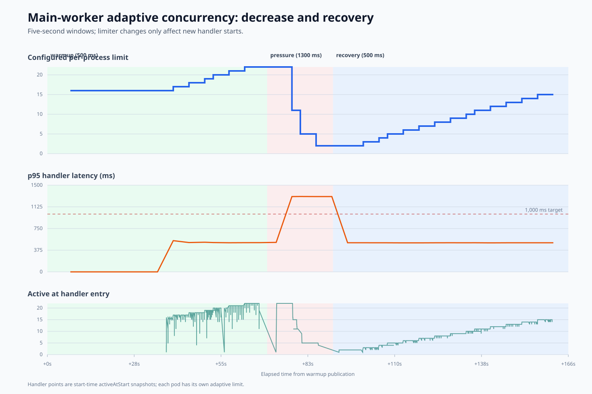

# Main-worker adaptive limiter demo

This isolated demo makes the main worker's adaptive concurrency policy
observable. It runs one main-worker pod through healthy, slow, and recovery
workloads, then produces a graph and logs for each limiter decision.

The example complements the [direct-Kafka demo](demo_direct-kafka.md) and
[HTTP admission demo](demo_http.md): those guides focus on admission and
1,200-record processing, while this demo focuses on the limiter's reaction to
measured handler latency.

## A. What is tested

The runner checks all three phases:

| Phase | Jobs | Handler hold | Expected limiter behavior |
| --- | ---: | ---: | --- |
| Warmup | 1,200 | 500 ms | Increase from the starting limit while backlog exists and p95 is healthy |
| Pressure | 160 | 1,300 ms | Halve the limit repeatedly in qualifying slow windows |
| Recovery | 1,200 | 500 ms | Increase from the reduced limit while backlog exists and p95 is healthy |

The handler delay is the controlled stand-in for a downstream operation. These
three values put the healthy phases well below 1,000 ms and the pressure phase
well above it, leaving room for normal scheduling overhead.

The run succeeds only when:

1. Every phase handles all of its unique load sequences.
2. Every phase reaches zero main-topic lag.
3. A warmup window increases the limit with healthy p95.
4. A pressure window decreases the limit with at least 20 completions and slow
   p95.
5. A recovery window increases the reduced limit with healthy p95.

This tests per-process limiter behavior only. It does not prove a cluster-wide
budget, global ordering, durable deduplication, external-effect fencing, or
retry/DLQ behavior. It also uses one main-worker pod, so the limit shown in the
graph is not aggregate worker capacity.

## B. Limiter policy and parameters

This demo follows the main-worker policy in [Spec 002 §7](specs/002-kafka-job-scheduling.md#7-main-adaptive-limiter-and-backpressure)
and [ADR 9](arch.md#adr-9-adaptive-limiter-for-main-token-bucket-for-retry).

| Parameter | Demo setting |
| --- | --- |
| Main-worker pods | 1 (`main-worker-a`) |
| Kafka partitions | 12 |
| Initial process limit | 16 by default; `INITIAL_LIMIT=8` through `24` |
| Limiter bounds | 1–128 permits |
| Evaluation window | 5 seconds |
| Minimum sample count | 20 completed attempts |
| Slow-latency trigger | p95 handler latency greater than 1,000 ms |
| Increase rule | +1 permit when backlog exists and the window is healthy |
| Decrease rule | Halve, round down, with a minimum of 1 |
| Initial- and retained-work bounds | Runner sets retained work to 250 records |
| Kafka host port | 19092 by default; override with `KAFKA_HOST_PORT` |
| Random seed | 1202 |

The limit controls admission of new handlers. A decrease does **not** cancel
running handlers; it prevents new starts until active work is below the new
limit. Different job IDs may still run concurrently.

### What p95 means

For each window, the worker measures the elapsed time of each completed handler
invocation separately from queue wait. It sorts those latencies and selects the
nearest-rank 95th percentile: the sample at
`ceil(number of samples × 0.95)`.

For example, in a window containing 100 completed attempts, p95 is the 95th
value after sorting from fastest to slowest. Roughly 95% of the observed
attempts completed no slower than that value. This captures most of the latency
tail without letting one exceptional outlier alone control the decision as a
maximum would.

Queue wait is intentionally excluded. p95 measures time spent in the handler,
so the limiter reacts to pressure on or inside the handler's work rather than to
the waiting caused by its own concurrency limit.

### Why the target is 1,000 ms

The 1,000 ms value is the Spec 002 policy's default one-second handler-latency
target. It is a control threshold, not a Kafka guarantee or a claim that every
production handler should finish within one second. A deployment should choose
the target from its downstream capacity and latency expectations.

The current implementation uses 1,000 ms directly in the limiter:

- `p95 > 1000 ms` is slow and can halve the limit.
- `p95 <= 1000 ms` is not slow, so a window with backlog and no other
  instability can add one permit.
- 10% transient failures, throttling, or timeouts are also decrease signals.

The 500 ms and 1,300 ms demo holds were chosen to sit clearly on opposite sides
of that threshold. Actual p95 is slightly above each configured hold because it
includes handler completion and scheduling overhead. For the recorded run it was
about 504–540 ms in healthy windows and 1,303–1,304 ms in pressure windows.

Spec 002 describes the one-second target as configurable. In the current code it
is hard-coded in `AdaptiveLimiter`; changing it requires a code change.

## C. Run the demo

From the repository root:

```sh
bash scripts/run-demo-adaptive-limiter.sh
```

To choose a different initial limit:

```sh
INITIAL_LIMIT=12 bash scripts/run-demo-adaptive-limiter.sh
```

The runner builds and starts a separate Compose project named
`adaptive-limiter-demo`; it does not stop or reuse the regular demo stack. The
broker is published on host port `19092` unless `KAFKA_HOST_PORT` is set.

To stop the isolated containers and network after reviewing the evidence:

```sh
docker compose --project-name adaptive-limiter-demo down
```

That leaves the named Kafka volume intact. Remove persistent demo data only when
you intentionally want to discard its Kafka backlog and offsets.

## D. Recorded result



The recorded run began at 16 permits:

| Evidence | Observation |
| --- | --- |
| Warmup | 16 → 17 at p95 540 ms with 64 completions |
| Pressure | 22 → 11 at p95 1,303 ms with 66 completions |
| Further pressure windows | 11 → 5 → 2 |
| Recovery | 2 → 3 at p95 504 ms with 20 completions |
| Phase completion | 1,200 warmup, 160 pressure, and 1,200 recovery handlers; zero final lag in each phase |

The increasing healthy windows are deliberately gradual: one qualifying window
adds at most one permit. A slow qualifying window has a stronger response:
halving the current limit. Windows with fewer than 20 attempts normally hold the
limit, which is why small completion counts are visible in the log without a
change.

## E. Evidence

- [Result graph](docs/diagrams/demo-adaptive-limiter.svg)
- [Summary](docs/tasks/evidence/DEMO1202-adaptive-limiter-summary.txt)
- [Limiter-window log](docs/tasks/evidence/DEMO1202-adaptive-limiter-windows.log)
- [Timestamped handler log](docs/tasks/evidence/DEMO1202-adaptive-limiter-handlers.log)
- [Phase boundaries and counts](docs/tasks/evidence/DEMO1202-adaptive-limiter-phases.tsv)
- [Runner](scripts/run-demo-adaptive-limiter.sh)
- [Limiter implementation](src/main/java/com/example/agenticjobscheduler/execution/AdaptiveLimiter.java)
