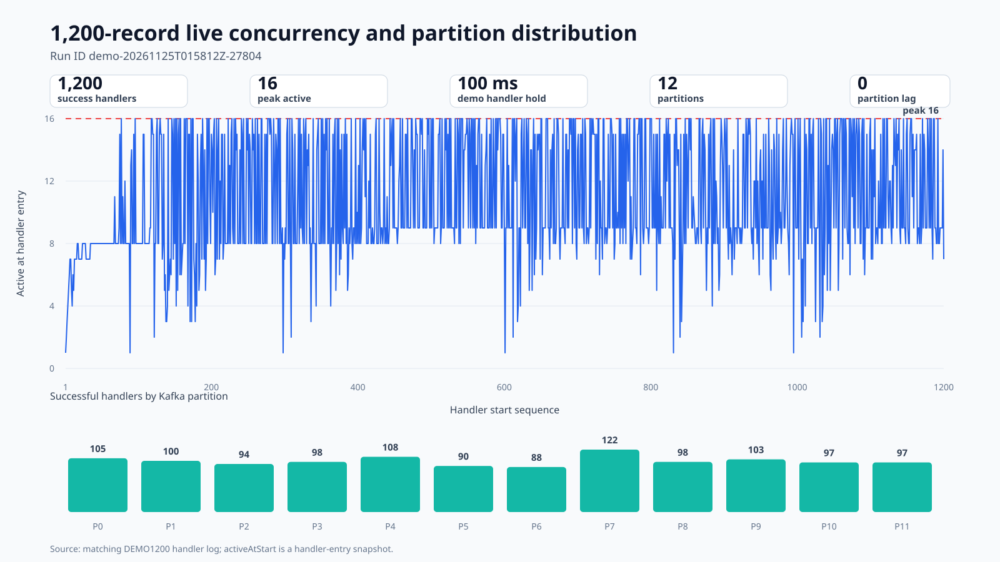
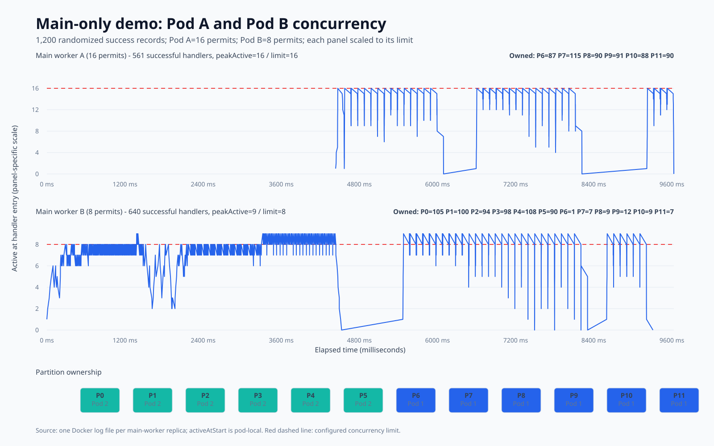

# 1,200-record HTTP admission demo

This run exercises the same 1,200-record Kafka worker workload as the
[direct-Kafka demo](demo_direct-kafka.md), but admission goes through
`POST /v1/jobs` on the separate HTTP API role.

## Command

```sh
./scripts/run-demo-1200.sh --transport http
```

Run ID: `demo-20261125T015812Z-27804`

## Result

| Check | Result |
| --- | --- |
| HTTP admissions acknowledged | 1,200 |
| Unique handler sequences | 1,200 |
| Handler log lines including replay | 1,201 |
| Duplicate replay lines | 1 |
| P0-P11 final lag | 0 |
| Pod A handlers / configured permits | 561 / 16 |
| Pod B handlers / configured permits | 640 / 8 |
| Peak active handlers | 16 |
| Handler delay | 100 ms |
| Random seed | 1,200 |

Partition counts:

```text
P0=105, P1=100, P2=94, P3=98, P4=108, P5=90,
P6=88, P7=122, P8=98, P9=103, P10=97, P11=97
```

Every HTTP request was accepted only after the API's Kafka producer
acknowledgment. The worker logs and zero-lag Kafka group state independently
show completed processing and committed prefixes. The one replayed handler line
is permitted by Spec 002's delivery model; this demo does not claim durable
deduplication.

## Concurrency and partition plot



## Per-pod concurrency plot



## Evidence

- [Producer log](docs/tasks/evidence/DEMO1200-http-producer.log)
- [Summary](docs/tasks/evidence/DEMO1200-http-concurrency-summary.txt)
- [Timestamped handler log](docs/tasks/evidence/DEMO1200-http-concurrency-success-handler-log.txt)
- [Kafka consumer-group offsets](docs/tasks/evidence/DEMO1200-http-concurrency-group-offsets.txt)
- [Pod A log](docs/tasks/evidence/DEMO1200-http-main-pod-a-concurrency.log)
- [Pod B log](docs/tasks/evidence/DEMO1200-http-main-pod-b-concurrency.log)

The first live attempt exposed two runner-observation issues rather than a
workload failure: readiness depends on the producer's first successful send, so
the runner now waits for HTTP liveness before admission; and Kafka CLI output can
start with a blank line, so lag parsing now counts only `job-main-v1` data rows.
No extra records were published to finalize the run after the lag correction.
