# Runtime scenario visual atlas

Visual companion to [arc42 Section 6.8](../arch.md#68-runtime-scenarios-20000-requestsday-thirteen-main-partitions-seven-main-pods).

All diagrams are editable **Mermaid source rendered directly by GitHub**. They illustrate expected behavior and test oracles, not proof that fault-injection tests have passed. The baseline is **20,000 jobs/day, 1,317 arrivals in the planned busy hour, 13 main partitions, 7 main-worker pods**. There are 49 scenarios below.

## Normal and positive scenarios

### R-P01: All 7 main pods start simultaneously on an empty group

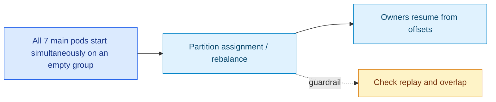

**Expected / verify:** Group stabilizes with all 7 consumers assigned partitions (six with two, one with one under balanced assignment); no records lost

### R-P02: 1,317 new requests arrive evenly within a busy hour

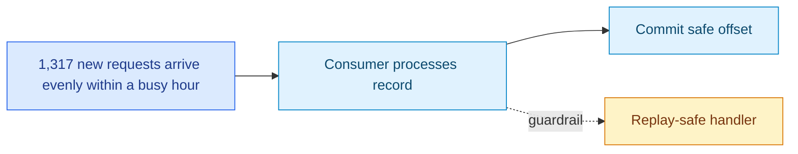

**Expected / verify:** Seven assigned pods consume their partitions; distinct jobIds run concurrently up to available permits; lag stays bounded if measured service capacity exceeds arrivals

### R-P03: 20,000 jobs arrive across one day with quieter hours


**Expected / verify:** Kafka buffers arrival variance; no need to spin up a thread per message; monitor queue age as well as lag

### R-P04: Two successive messages with same jobId share a partition

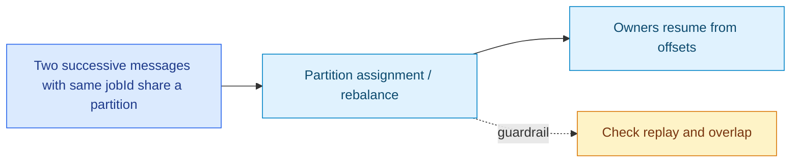

**Expected / verify:** Second waits behind first in that partition's per-job FIFO gate; unrelated IDs can overlap

### R-P05: Different jobs finish out of offset order

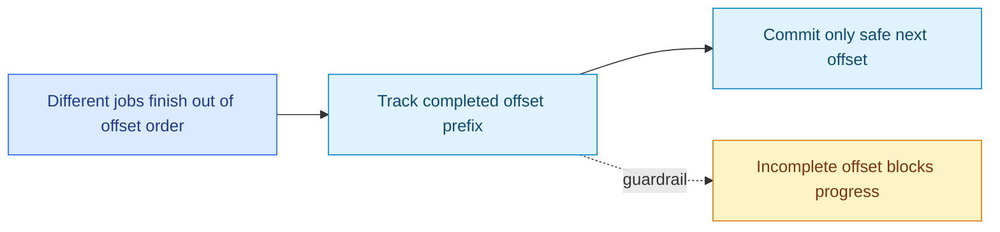

**Expected / verify:** `OffsetCommitTracker` commits only the complete contiguous prefix for each partition; later completed records remain retained

### R-P06: Slow but healthy downstream reduces available permits

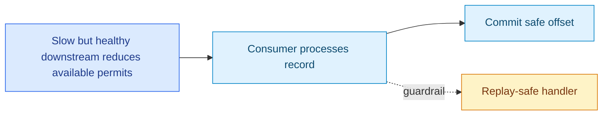

**Expected / verify:** Adaptive limiter reduces admission/concurrency, window pauses partition intake, then resumes below low watermark; Kafka retains backlog

### R-P07: An assigned pod terminates *after* its handler and offset commit complete

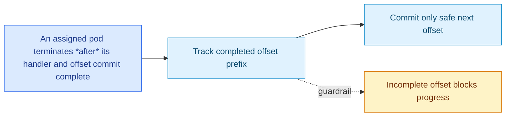

**Expected / verify:** Surviving consumers rebalance and continue at committed next offsets; a replacement pod may take ownership

## Failure and negative scenarios

### R-N01: 7 pods and 13 partitions

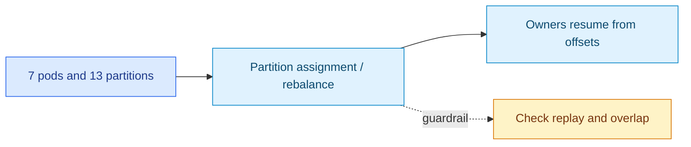

**Expected / verify:** All seven pods receive partitions, but six own two partitions and one owns one; validate uneven per-pod loads and process-level limiter contention

### R-N02: All 7 assigned pods fail

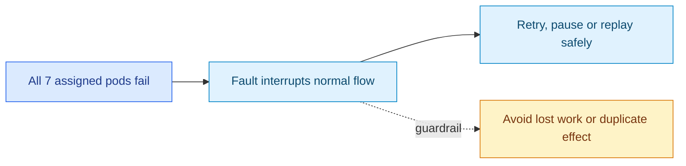

**Expected / verify:** No consumers remain to process 13 partitions until pods restart or replacements join; Kafka retains uncommitted records within retention

### R-N03: One active pod crashes before handler completion or offset commit

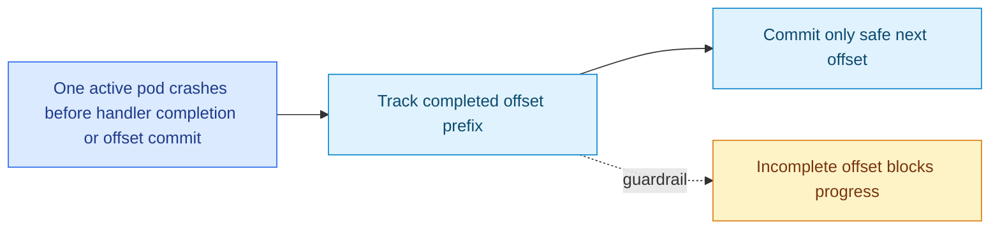

**Expected / verify:** Its uncommitted records replay on a new owner; target-side idempotency must withstand repeated external effects

### R-N04: Pod crashes *after* irreversible handler success but *before* offset acknowledgment

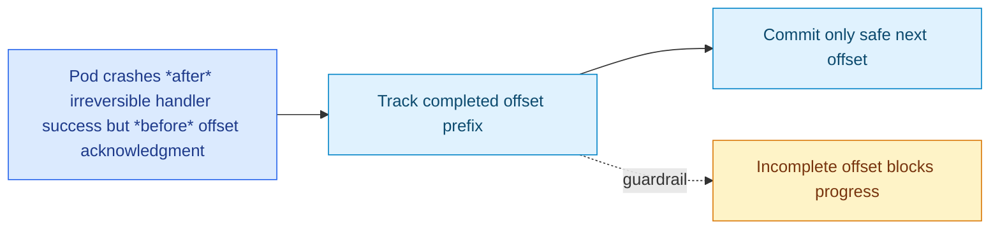

**Expected / verify:** Record replays despite completed effect. Verify same `(jobId, executionId)` cannot produce duplicate business effects at target

### R-N05: Rolling restart/HPA scale-up/down triggers rebalance during a 3-minute handler

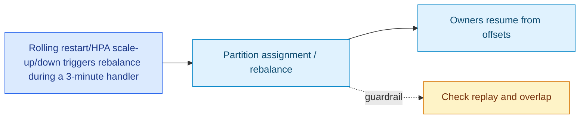

**Expected / verify:** Revocation stops new admission but does **not** cancel/fence old effects; new owner can replay concurrently. Expose duplicate-overlap window; external fencing is out of scope

### R-N06: All 7 pods are available but partition-key skew puts most jobs on P0


**Expected / verify:** P0 lag/oldest age rises while other owners are underutilized; no automatic work-stealing of P0 records across consumers

### R-N07: A permanently hung handler holds earliest uncommitted offset

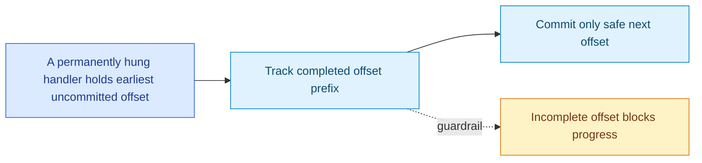

**Expected / verify:** Later finished records cannot advance that partition's committed prefix; retained-work window may saturate. Alert on stuck age and stalled committed offset

### R-N08: Offset 10 hangs while 11–100 complete

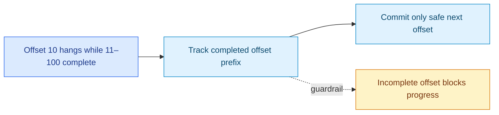

**Expected / verify:** Committing 101 would lose offset 10; verify tracker refuses gap-skipping and retained entries count toward window

### R-N09: Kafka commit request times out; outcome unknown

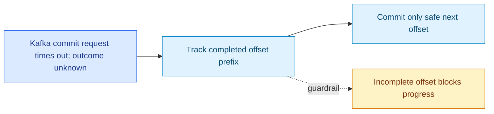

**Expected / verify:** Do not infer a failure or safe release; retain conservatively, retry/reconcile commits, and tolerate replay

### R-N10: Commit broker acknowledgment is lost after broker persisted the commit

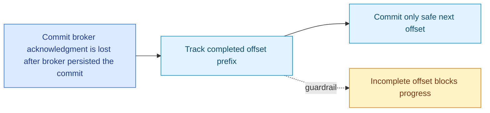

**Expected / verify:** Worker may believe commit failed; no unsafe release or false exactly-once claim; verify eventual recovery

### R-N11: Kafka unavailable for 30 minutes during busy hour


**Expected / verify:** About 659 *new* main requests would arrive if producers can still publish or buffer them; if broker unavailable, producer publish may fail and must be retried externally. On restoration, drain existing Kafka backlog while lag/age are monitored

### R-N12: Kafka outage extends beyond topic retention or disk capacity

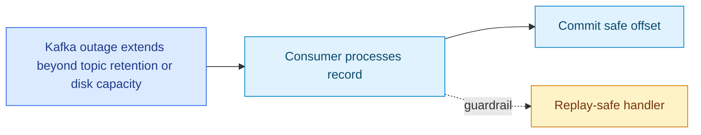

**Expected / verify:** Pending records can expire or producers can fail; offset-based design does not guarantee recovery once retained data disappears

### R-N13: Retryable handler failure and retry publish fails

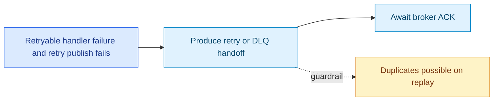

**Expected / verify:** Keep failed source incomplete and same-job gate held; retry identical handoff publication without re-invoking the handler

### R-N14: Retry publish succeeds, then source pod dies before commit

```mermaid
flowchart LR
  A["Retry publish succeeds, then source pod dies before commit"] --> B["Track completed offset prefix"] --> C["Commit only safe next offset"]
  B -. "guardrail" .-> D["Incomplete offset blocks progress"]
  classDef event fill:#dbeafe,stroke:#2563eb,color:#1e3a8a
  classDef action fill:#e0f2fe,stroke:#0284c7,color:#0c4a6e
  classDef warn fill:#fef3c7,stroke:#d97706,color:#78350f
  class A event
  class B,C action
  class D warn
```

**Expected / verify:** Source replays and can publish duplicate retry handoff; `handoffId` identifies duplicate but does not suppress it by itself

### R-N15: A main successor for job A arrives while older job A is running on retry topic

```mermaid
flowchart LR
  A["A main successor for job A arrives while older job A is running on retry topic"] --> B["Produce retry or DLQ handoff"] --> C["Await broker ACK"]
  B -. "guardrail" .-> D["Duplicates possible on replay"]
  classDef event fill:#dbeafe,stroke:#2563eb,color:#1e3a8a
  classDef action fill:#e0f2fe,stroke:#0284c7,color:#0c4a6e
  classDef warn fill:#fef3c7,stroke:#d97706,color:#78350f
  class A event
  class B,C action
  class D warn
```

**Expected / verify:** Separate consumer groups/gates allow concurrent main and retry attempts; require downstream concurrency tolerance or future cross-topic fencing

### R-N16: Retry-worker pods absent/unhealthy while main workers are healthy

```mermaid
flowchart LR
  A["Retry-worker pods absent/unhealthy while main workers are healthy"] --> B["Produce retry or DLQ handoff"] --> C["Await broker ACK"]
  B -. "guardrail" .-> D["Duplicates possible on replay"]
  classDef event fill:#dbeafe,stroke:#2563eb,color:#1e3a8a
  classDef action fill:#e0f2fe,stroke:#0284c7,color:#0c4a6e
  classDef warn fill:#fef3c7,stroke:#d97706,color:#78350f
  class A event
  class B,C action
  class D warn
```

**Expected / verify:** Main throughput can continue but `jobs.retry.v1` lag/oldest age grows independently; no main pod automatically consumes retry work

### R-N17: Retry storm after a transient dependency outage

```mermaid
flowchart LR
  A["Retry storm after a transient dependency outage"] --> B["Produce retry or DLQ handoff"] --> C["Await broker ACK"]
  B -. "guardrail" .-> D["Duplicates possible on replay"]
  classDef event fill:#dbeafe,stroke:#2563eb,color:#1e3a8a
  classDef action fill:#e0f2fe,stroke:#0284c7,color:#0c4a6e
  classDef warn fill:#fef3c7,stroke:#d97706,color:#78350f
  class A event
  class B,C action
  class D warn
```

**Expected / verify:** One-start/second/pod retry throttle and retry concurrency limit reduce retry pressure; check backlog growth, downstream recovery and starvation

### R-N18: Invalid/oversized/wrong-partition input in main topic

```mermaid
flowchart LR
  A["Invalid/oversized/wrong-partition input in main topic"] --> B["Fault interrupts normal flow"] --> C["Retry, pause or replay safely"]
  B -. "guardrail" .-> D["Avoid lost work or duplicate effect"]
  classDef event fill:#dbeafe,stroke:#2563eb,color:#1e3a8a
  classDef action fill:#e0f2fe,stroke:#0284c7,color:#0c4a6e
  classDef warn fill:#fef3c7,stroke:#d97706,color:#78350f
  class A event
  class B,C action
  class D warn
```

**Expected / verify:** Validate before handler; publish bounded diagnostic DLQ record and wait for ACK before marking source complete

### R-N19: DLQ publication fails during malformed-record handling

```mermaid
flowchart LR
  A["DLQ publication fails during malformed-record handling"] --> B["Produce retry or DLQ handoff"] --> C["Await broker ACK"]
  B -. "guardrail" .-> D["Duplicates possible on replay"]
  classDef event fill:#dbeafe,stroke:#2563eb,color:#1e3a8a
  classDef action fill:#e0f2fe,stroke:#0284c7,color:#0c4a6e
  classDef warn fill:#fef3c7,stroke:#d97706,color:#78350f
  class A event
  class B,C action
  class D warn
```

**Expected / verify:** Invalid source cannot be safely committed; keep it pending, back off/retry publication, monitor stuck DLQ handoffs

### R-N20: Adaptive main limiter falls below sustainable required capacity due to elevated failures/latency

```mermaid
flowchart LR
  A["Adaptive main limiter falls below sustainable required capacity due to elevated failures/latency"] --> B["Apply bounded backpressure"] --> C["Retain remaining work in Kafka"]
  B -. "guardrail" .-> D["Track oldest queued age"]
  classDef event fill:#dbeafe,stroke:#2563eb,color:#1e3a8a
  classDef action fill:#e0f2fe,stroke:#0284c7,color:#0c4a6e
  classDef warn fill:#fef3c7,stroke:#d97706,color:#78350f
  class A event
  class B,C action
  class D warn
```

**Expected / verify:** Lag and oldest age climb; verify limiter stabilization/recovery without overwhelming downstream dependencies

### R-N21: Per-process 1,000-record/16 MiB processing window hits high watermark

```mermaid
flowchart LR
  A["Per-process 1,000-record/16 MiB processing window hits high watermark"] --> B["Apply bounded backpressure"] --> C["Retain remaining work in Kafka"]
  B -. "guardrail" .-> D["Track oldest queued age"]
  classDef event fill:#dbeafe,stroke:#2563eb,color:#1e3a8a
  classDef action fill:#e0f2fe,stroke:#0284c7,color:#0c4a6e
  classDef warn fill:#fef3c7,stroke:#d97706,color:#78350f
  class A event
  class B,C action
  class D warn
```

**Expected / verify:** Intake pauses for owned partitions; previously polled/reserved records remain bounded; resume only after acknowledged offset commits free sufficient capacity

### R-N22: A rebalance occurs while a consumer has paused partitions and retained work

```mermaid
flowchart LR
  A["A rebalance occurs while a consumer has paused partitions and retained work"] --> B["Partition assignment / rebalance"] --> C["Owners resume from offsets"]
  B -. "guardrail" .-> D["Check replay and overlap"]
  classDef event fill:#dbeafe,stroke:#2563eb,color:#1e3a8a
  classDef action fill:#e0f2fe,stroke:#0284c7,color:#0c4a6e
  classDef warn fill:#fef3c7,stroke:#d97706,color:#78350f
  class A event
  class B,C action
  class D warn
```

**Expected / verify:** Old owner must stop admission and discard revoked tracking; new owner reconstructs from Kafka offsets without inheriting stale local state

### R-N23: Consumer exceeds `max.poll.interval.ms` due to blocking handler or event-loop starvation

```mermaid
flowchart LR
  A["Consumer exceeds max.poll.interval.ms due to blocking handler or event-loop starvation"] --> B["Partition assignment / rebalance"] --> C["Owners resume from offsets"]
  B -. "guardrail" .-> D["Check replay and overlap"]
  classDef event fill:#dbeafe,stroke:#2563eb,color:#1e3a8a
  classDef action fill:#e0f2fe,stroke:#0284c7,color:#0c4a6e
  classDef warn fill:#fef3c7,stroke:#d97706,color:#78350f
  class A event
  class B,C action
  class D warn
```

**Expected / verify:** Consumer may lose group membership and replay occurs; verify handler is nonblocking and poll/heartbeat progress remains healthy

### R-N24: Thirteen partitions hit hot-spot processing and operator increases main pods 7 → 20

```mermaid
flowchart LR
  A["Thirteen partitions hit hot-spot processing and operator increases main pods 7 → 20"] --> B["Partition assignment / rebalance"] --> C["Owners resume from offsets"]
  B -. "guardrail" .-> D["Check replay and overlap"]
  classDef event fill:#dbeafe,stroke:#2563eb,color:#1e3a8a
  classDef action fill:#e0f2fe,stroke:#0284c7,color:#0c4a6e
  classDef warn fill:#fef3c7,stroke:#d97706,color:#78350f
  class A event
  class B,C action
  class D warn
```

**Expected / verify:** Only 13 of 20 consumers can own partitions; additional pods beyond 13 do not fix a single hot partition; improve per-owner execution capacity or revisit partition/key strategy

### R-N25: Partition count changed from 13 to 26 in place

```mermaid
flowchart LR
  A["Partition count changed from 13 to 26 in place"] --> B["Fault interrupts normal flow"] --> C["Retry, pause or replay safely"]
  B -. "guardrail" .-> D["Avoid lost work or duplicate effect"]
  classDef event fill:#dbeafe,stroke:#2563eb,color:#1e3a8a
  classDef action fill:#e0f2fe,stroke:#0284c7,color:#0c4a6e
  classDef warn fill:#fef3c7,stroke:#d97706,color:#78350f
  class A event
  class B,C action
  class D warn
```

**Expected / verify:** Kafka key-to-partition mapping can change, breaking intended same-job lane assumptions for existing records; require controlled migration/repartition plan

### R-N26: Topic receives 1,317 requests in one minute, not spread over an hour

```mermaid
flowchart LR
  A["Topic receives 1,317 requests in one minute, not spread over an hour"] --> B["Consumer processes record"] --> C["Commit safe offset"]
  B -. "guardrail" .-> D["Replay-safe handler"]
  classDef event fill:#dbeafe,stroke:#2563eb,color:#1e3a8a
  classDef action fill:#e0f2fe,stroke:#0284c7,color:#0c4a6e
  classDef warn fill:#fef3c7,stroke:#d97706,color:#78350f
  class A event
  class B,C action
  class D warn
```

**Expected / verify:** Short-term backlog/window pressure can be much higher than hourly-average model suggests; test burst absorption and recovery, not just hourly arithmetic

### R-N27: Poison handler always fails, repeatedly routed into retry and then DLQ

```mermaid
flowchart LR
  A["Poison handler always fails, repeatedly routed into retry and then DLQ"] --> B["Produce retry or DLQ handoff"] --> C["Await broker ACK"]
  B -. "guardrail" .-> D["Duplicates possible on replay"]
  classDef event fill:#dbeafe,stroke:#2563eb,color:#1e3a8a
  classDef action fill:#e0f2fe,stroke:#0284c7,color:#0c4a6e
  classDef warn fill:#fef3c7,stroke:#d97706,color:#78350f
  class A event
  class B,C action
  class D warn
```

**Expected / verify:** Verify retry attempt bound, terminal DLQ handoff ACK, no endless source re-execution from handoff-send failures

### R-N28: Group has unstable membership (repeated pod crash loops or network flaps)

```mermaid
flowchart LR
  A["Group has unstable membership (repeated pod crash loops or network flaps)"] --> B["Fault interrupts normal flow"] --> C["Retry, pause or replay safely"]
  B -. "guardrail" .-> D["Avoid lost work or duplicate effect"]
  classDef event fill:#dbeafe,stroke:#2563eb,color:#1e3a8a
  classDef action fill:#e0f2fe,stroke:#0284c7,color:#0c4a6e
  classDef warn fill:#fef3c7,stroke:#d97706,color:#78350f
  class A event
  class B,C action
  class D warn
```

**Expected / verify:** Rebalances cause interrupted ownership and replay; alert on rebalance frequency and duplicate-effect rate

### R-N29: Kafka broker leader changes during commit/retry handoff

```mermaid
flowchart LR
  A["Kafka broker leader changes during commit/retry handoff"] --> B["Track completed offset prefix"] --> C["Commit only safe next offset"]
  B -. "guardrail" .-> D["Incomplete offset blocks progress"]
  classDef event fill:#dbeafe,stroke:#2563eb,color:#1e3a8a
  classDef action fill:#e0f2fe,stroke:#0284c7,color:#0c4a6e
  classDef warn fill:#fef3c7,stroke:#d97706,color:#78350f
  class A event
  class B,C action
  class D warn
```

**Expected / verify:** Timeouts/ambiguous outcomes can cause replay or duplicate publication; enforce source-commit ordering and idempotent downstream operations

### R-N30: After scaling beyond 13 pods, consumer has zero partitions but still reports Ready

```mermaid
flowchart LR
  A["After scaling beyond 13 pods, consumer has zero partitions but still reports Ready"] --> B["Partition assignment / rebalance"] --> C["Owners resume from offsets"]
  B -. "guardrail" .-> D["Check replay and overlap"]
  classDef event fill:#dbeafe,stroke:#2563eb,color:#1e3a8a
  classDef action fill:#e0f2fe,stroke:#0284c7,color:#0c4a6e
  classDef warn fill:#fef3c7,stroke:#d97706,color:#78350f
  class A event
  class B,C action
  class D warn
```

**Expected / verify:** Readiness alone overstates useful capacity; export owned-partition count and active processing metrics per pod

### R-N31: External side effect succeeds then handler future never completes

```mermaid
flowchart LR
  A["External side effect succeeds then handler future never completes"] --> B["Consumer processes record"] --> C["Commit safe offset"]
  B -. "guardrail" .-> D["Replay-safe handler"]
  classDef event fill:#dbeafe,stroke:#2563eb,color:#1e3a8a
  classDef action fill:#e0f2fe,stroke:#0284c7,color:#0c4a6e
  classDef warn fill:#fef3c7,stroke:#d97706,color:#78350f
  class A event
  class B,C action
  class D warn
```

**Expected / verify:** Contract violation can leave in-flight work stuck and later replayed; expose execution timeout/age, require safe cancellation or recovery policy

### R-N32: One partition has too many jobs for one active pod despite 6 other healthy pods

```mermaid
flowchart LR
  A["One partition has too many jobs for one active pod despite 6 other healthy pods"] --> B["Partition assignment / rebalance"] --> C["Owners resume from offsets"]
  B -. "guardrail" .-> D["Check replay and overlap"]
  classDef event fill:#dbeafe,stroke:#2563eb,color:#1e3a8a
  classDef action fill:#e0f2fe,stroke:#0284c7,color:#0c4a6e
  classDef warn fill:#fef3c7,stroke:#d97706,color:#78350f
  class A event
  class B,C action
  class D warn
```

**Expected / verify:** Another consumer cannot simultaneously own that partition within the same group; partition-level headroom and key distribution determine scaling

## Mid-flight lifecycle timelines

### R-T10: Pod joins while P0 has a stuck offset and a full retained window.

```mermaid
flowchart TD
 A["P0 earliest offset stuck"] --> B["Later jobs complete"] --> C["Safe prefix cannot advance"] --> D["Retained window fills"]
 D --> E["New pod joins; P0 reassigned"] --> F["Replay from committed offset"] --> G{"Handler still stuck?"}
 G -- Yes --> H["Alert / explicit recovery required"]
 G -- No --> I["Advance safe prefix and release window"]
```

### R-T01: Pod 8 joins halfway through a 1,317-request busy hour (scale 7 → 8).

```mermaid
sequenceDiagram
 participant K as Kafka (13 partitions)
 participant A as Pods 1–7
 participant B as Pod 8
 Note over A,K: Midway through busy hour; some jobs still in flight
 B->>K: Join job-main-v1
 K-->>A: Revoke reassigned partitions
 Note over A: Stop admitting revoked work
 K-->>B: Assign partitions + committed offsets
 B->>K: Fetch uncommitted records
 B->>B: Replay with fresh jobId gates
 Note over A,B: Old external effects may overlap replay; idempotency required
```

### R-T02: Pod 3 dies abruptly halfway through executing two partitions (7 → 6).

```mermaid
sequenceDiagram
 participant K as Kafka
 participant P as Pod 3 (P4, P11)
 participant S as Six survivors
 K-->>P: Deliver jobs A and B
 P->>P: Execute; some offsets uncommitted
 Note over P: SIGKILL / node failure
 P-xK: No heartbeats
 K-->>S: Reassign P4 and P11
 S->>K: Fetch from committed next offsets
 S->>S: Replay unfinished / uncommitted work
 Note over S: Verify idempotency; backlog and age recover
```

### R-T03: Graceful pod termination during a long-running job.

```mermaid
flowchart TD
 A["Pod receives shutdown"] --> B["Pause intake and dispatch"] --> C{"Handlers finish within 30s?"}
 C -- Yes --> D["Commit eligible prefixes"] --> E["Clean exit"]
 C -- No --> F["Leave uncommitted work"] --> G["New owner replays"]
 G --> H["Target-side idempotency"]
```

### R-T04: Pod replacement returns after R-T02 (6 → 7).

```mermaid
sequenceDiagram
 participant K as Kafka group
 participant S as Six surviving pods
 participant R as Replacement pod
 Note over S,K: Survivors own all 13 partitions
 R->>K: Join consumer group
 K-->>S: Revoke some partitions
 K-->>R: Assign partition(s)
 R->>K: Read committed offset
 R->>R: Rebuild gates and process backlog
 Note over R: Old partition ownership not guaranteed
```

### R-T05: Scale all the way from 7 → 13 pods during backlog.

```mermaid
flowchart LR
 A["7 pods / 13 partitions"] --> B["Scale 8..12"] --> C["13 pods / 13 partitions"] --> D["14 pods"]
 A --- E["All 7 own work"]
 C --- F["One partition per pod"]
 D --- G["One pod unassigned"]
 classDef warning fill:#fef3c7,stroke:#d97706,color:#78350f
 class G warning
```

### R-T06: Pod joins while a retry handoff is awaiting broker ACK.

```mermaid
sequenceDiagram
 participant K as Main Kafka
 participant O as Old owner
 participant N as New owner
 participant R as Retry topic
 O->>R: Publish retry handoff
 Note over O: Broker ACK pending
 N->>K: Join group; rebalance
 K-->>O: Revoke partition
 K-->>N: Assign from committed offset
 N->>K: Replay failed source
 N->>R: Publish same handoffId
 Note over R: Duplicate handoff possible
```

### R-T07: Partition ownership changes during an ambiguous commit timeout.

```mermaid
sequenceDiagram
 participant O as Old owner
 participant K as Kafka broker
 participant N as New owner
 O->>K: Commit offset 501
 Note over K: Commit ACK delayed / lost
 N->>K: Join group after rebalance
 K-->>N: Effective committed next offset
 N->>K: Fetch from broker position
 Note over N: Never trust old in-memory tracker
 Note over O,N: Verify no skipped unfinished records
```

### R-T08: Repeated 7 → 8 → 7 autoscaling while jobs run.

```mermaid
flowchart LR
 A["7 pods"] -->|Scale up| B["8 pods"] -->|Scale down| C["7 pods"] -->|Repeat| A
 A -.-> D["Rebalance + offset replay"]
 B -.-> D
 D --> E["Measure thrash, duplicate effects, oldest age"]
```

### R-T09: Two pod failures during the same busy hour (7 → 5).

```mermaid
flowchart TD
 A["7 pods / 13 partitions"] --> B["Two pods fail"] --> C["5 surviving pods"]
 C --> D["3 pods own 3 partitions each"]
 C --> E["2 pods own 2 partitions each"]
 D --> F["Shared limiter/window pressure"]
 E --> F
 F --> G["Backlog recovery and capacity test"]
```

